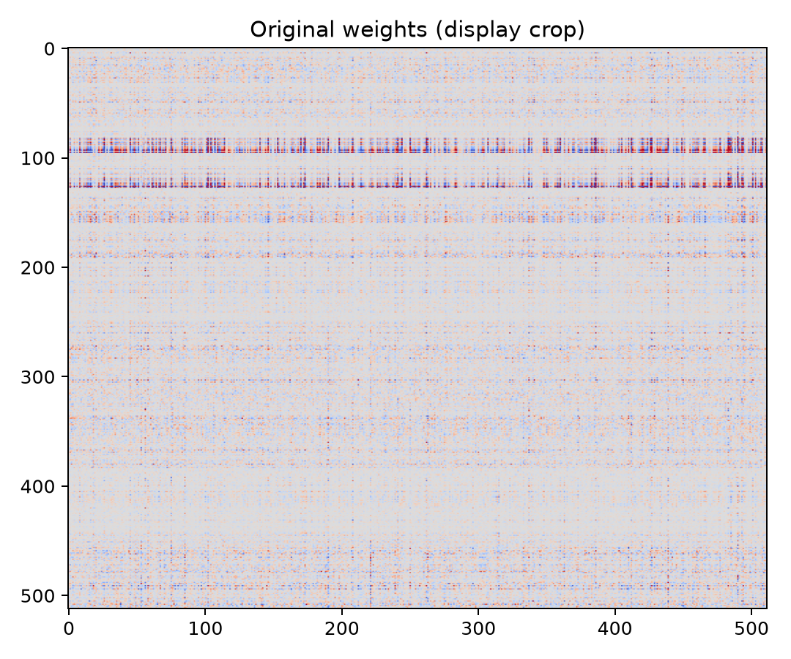
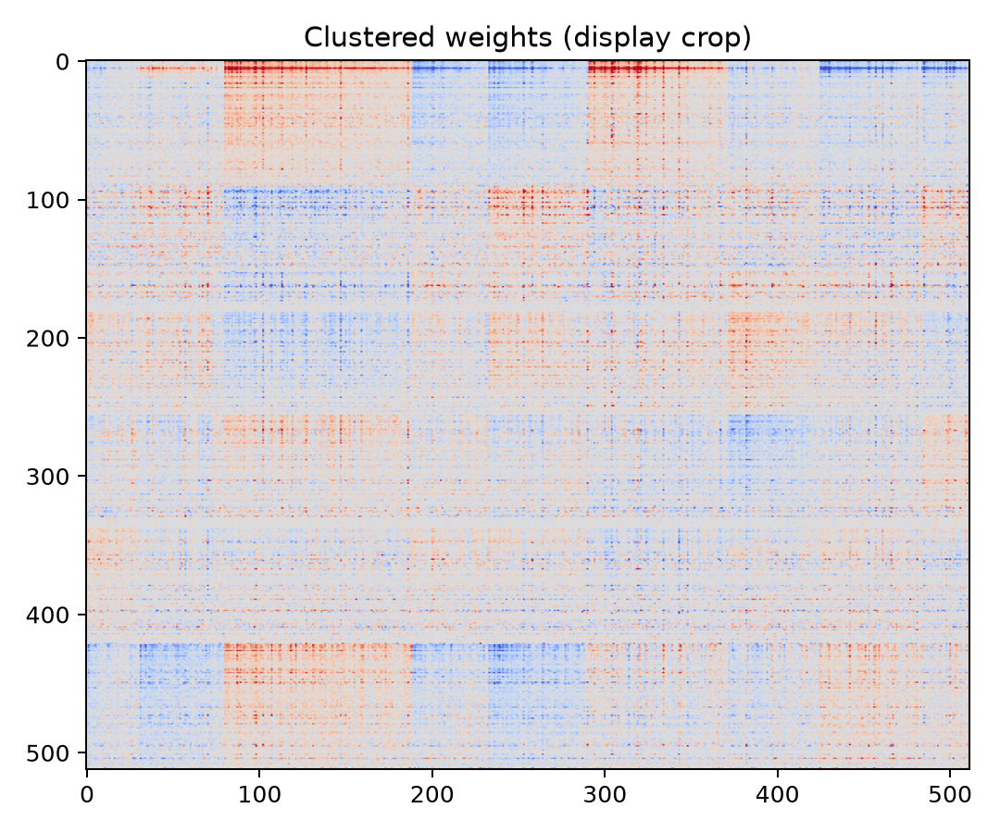
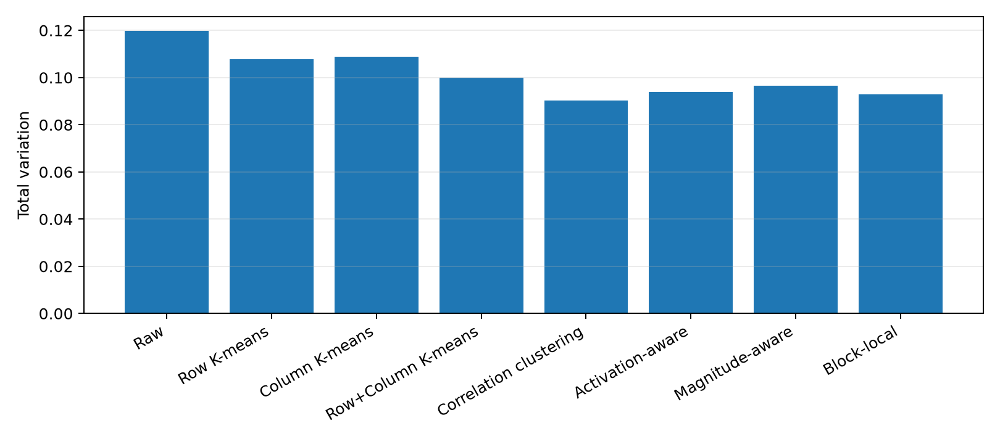
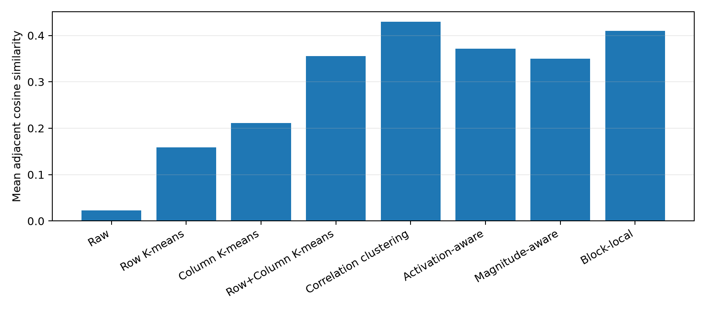
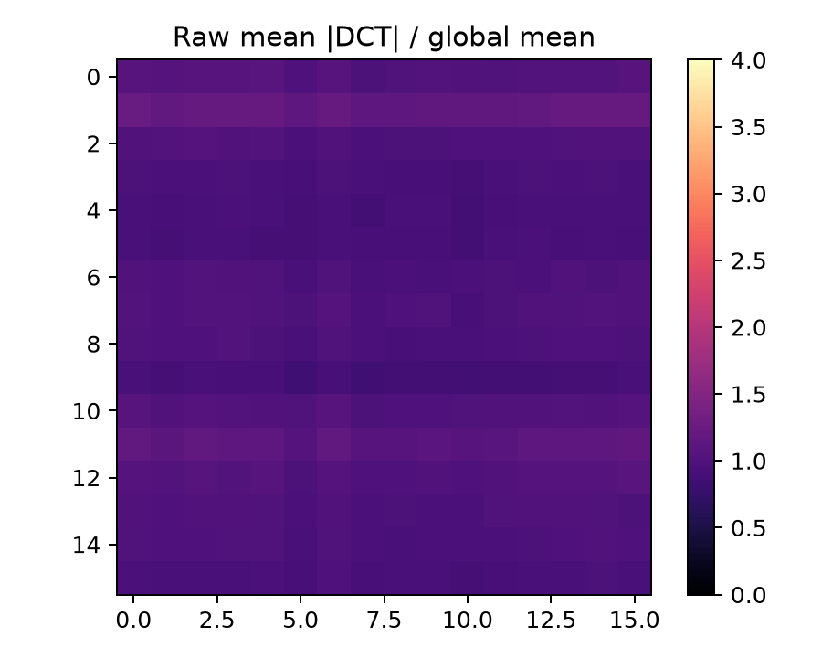
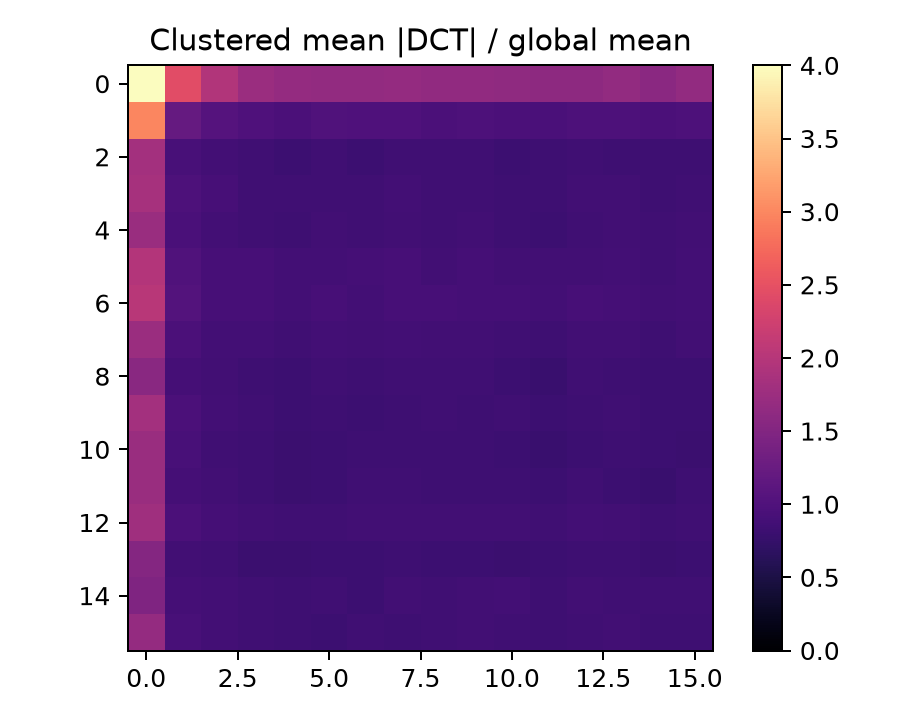
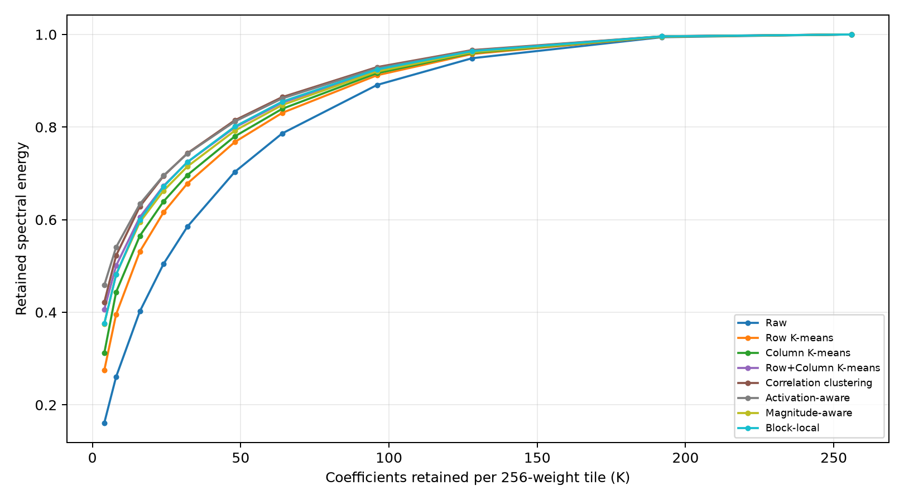
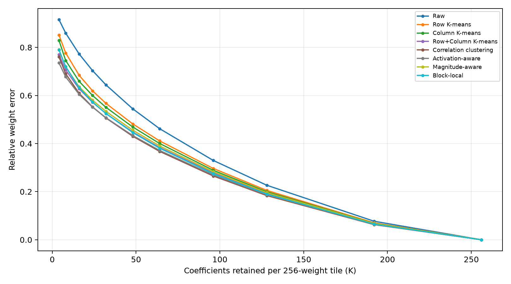
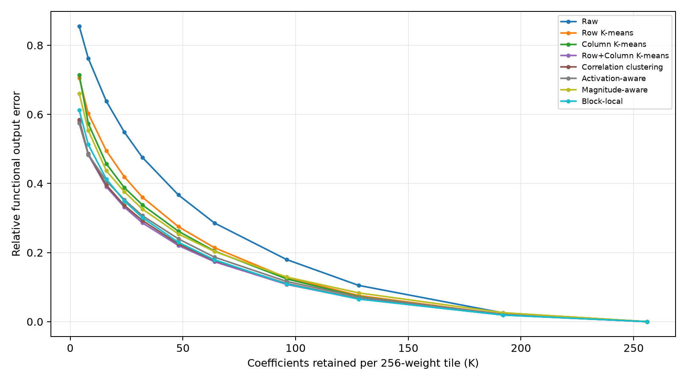
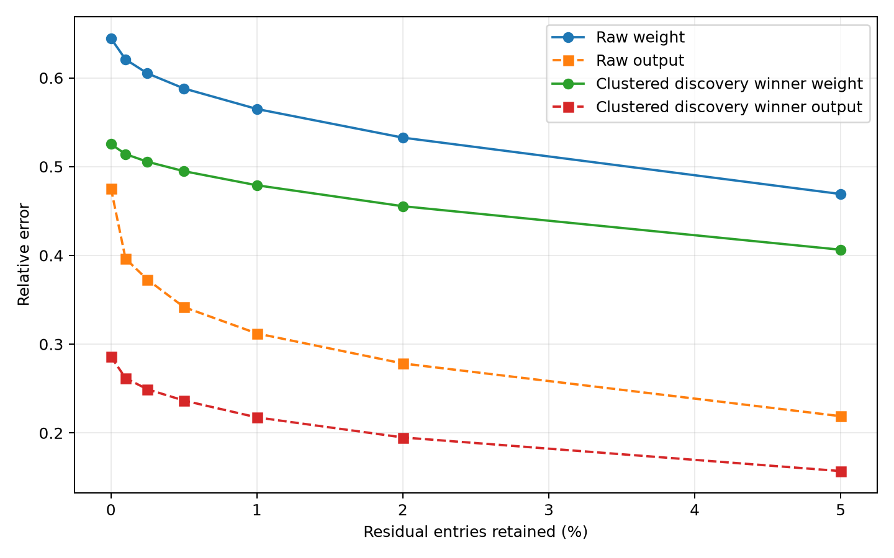

# WaveFly clustering experiment

## A. Raw DCT baseline

The discovery matrix was `Qwen/Qwen2.5-0.5B/model.layers.0.self_attn.q_proj` (896×896), evaluated with 3136 complete 16×16 tiles and 896×896 full-matrix functional reconstruction. At K=32 magnitude Top-K, raw ordering retained 58.4709% of spectral energy, produced 64.4431% relative weight error, and 47.5581% relative output error. Fixed low-frequency and magnitude Top-K results for every requested K are in `measurements.csv`.

## B. Clustering effect

Only complete rows and columns were permuted. For every configuration, exact index uniqueness and `P_r^T(P_r W P_c)P_c^T == W` were asserted before DCT; all recorded permutation round-trip maxima are zero. The search tested raw and normalized vectors, 4/8/16/32/64 clusters, centroid-distance/norm/PCA within-cluster order, row-only, column-only, both axes, spherical/correlation clustering, activation augmentation, magnitude features, and 128/256 block-local ordering.

The discovery search selected `both_k16_norm_centroid` by minimum K=32 functional error on the same layer. It reduced total variation from 0.119829 to 0.0998398; mean adjacent cosine similarity moved from 0.0223526 to 0.355363. Search selection and evaluation on the same matrix make this an in-sample result. Across 33 independent validation matrices, the same method changed average total variation from 0.0630603 to 0.0586704, row correlation from 0.00903567 to 0.0667601, and column correlation from 0.00336263 to 0.0881578.

| Method | Configuration | TV | Neighbor corr | Top-16 | Top-32 | Top-64 | Weight error | Output error | Perm BPW |
| --- | --- | --- | --- | --- | --- | --- | --- | --- | --- |
| Raw | raw | 0.119829 | 0.0223526 | 0.402208 | 0.584709 | 0.786301 | 0.644431 | 0.475581 | 0 |
| Row K-means | row_k8_norm_pca | 0.1078 | 0.15839 | 0.531389 | 0.678004 | 0.830655 | 0.567447 | 0.360357 | 0.0111607 |
| Column K-means | col_k16_norm_centroid | 0.108743 | 0.211446 | 0.565194 | 0.696236 | 0.839423 | 0.551148 | 0.338018 | 0.0111607 |
| Row+Column K-means | both_k16_norm_centroid | 0.0998398 | 0.355363 | 0.605549 | 0.724007 | 0.852674 | 0.525351 | 0.286026 | 0.0223214 |
| Correlation clustering | correlation_k64 | 0.0901702 | 0.429647 | 0.628596 | 0.743355 | 0.86472 | 0.506601 | 0.292894 | 0.0223214 |
| Activation-aware | activation_a0.1 | 0.0940442 | 0.371045 | 0.63399 | 0.742449 | 0.861844 | 0.507495 | 0.306762 | 0.0223214 |
| Magnitude-aware | magnitude_a0.25 | 0.0965373 | 0.350022 | 0.594666 | 0.714693 | 0.847537 | 0.534141 | 0.326057 | 0.0223214 |
| Block-local | local256_both | 0.0929312 | 0.409647 | 0.59973 | 0.724385 | 0.854898 | 0.52499 | 0.301084 | 0.0178571 |

## C. Spectral concentration

On the discovery layer, the winning ordering raised Top-32 energy from 58.4709% to 72.4007%. Across validation matrices it raised the unweighted layer mean from 51.1467% to 53.6864%. This is real concentration, but the validation shift is much smaller than the discovery result.

## D. Reconstruction

At discovery K=32 the winner reduced weight error from 64.4431% to 52.5351%. Across validation layers, error changed from 69.8522% to 67.7441%. The latter remains too large for direct deployment.

One-eighth coefficient retention for the winning method across tile sizes on the Qwen middle Q projection:

| tile | energy | weight_error | output_error | permutation_bpw |
| --- | --- | --- | --- | --- |
| 8 | 0.50237 | 0.705429 | 0.668621 | 0.0223214 |
| 32 | 0.517193 | 0.694843 | 0.643276 | 0.0223214 |

## E. Functional accuracy

Activations came from five fixed calibration passages. The metric reconstructs each complete matrix, undoes both permutations, and compares `XW^T` with `XW_hat^T`. On discovery, K=32 output error fell from 47.5581% to 28.6026%. Across validation matrices it fell from 65.3196% to 59.1162%; output cosine moved from 0.765397 to 0.792264. This is a material average improvement, but 59.12% error is not acceptable evidence of model fidelity. No perplexity was measured.

Per-family/type results, including early/middle/late Qwen layers and representative middle OPT/Pythia layers:

| model | type | method | energy | weight_error | output_error | output_cosine | permutation_bpw |
| --- | --- | --- | --- | --- | --- | --- | --- |
| EleutherAI/pythia-70m | attention_output | raw | 0.501431 | 0.706095 | 0.650455 | 0.76793 | 0 |
| EleutherAI/pythia-70m | attention_output | winner_both_k16_norm_centroid | 0.510908 | 0.699351 | 0.661337 | 0.752814 | 0.0351562 |
| EleutherAI/pythia-70m | dense_4h_to_h | raw | 0.501888 | 0.70577 | 0.684549 | 0.730981 | 0 |
| EleutherAI/pythia-70m | dense_4h_to_h | winner_both_k16_norm_centroid | 0.529761 | 0.685739 | 0.651507 | 0.759476 | 0.0258789 |
| EleutherAI/pythia-70m | dense_h_to_4h | raw | 0.50079 | 0.706548 | 0.672998 | 0.740892 | 0 |
| EleutherAI/pythia-70m | dense_h_to_4h | winner_both_k16_norm_centroid | 0.508303 | 0.701211 | 0.60792 | 0.793998 | 0.0258789 |
| EleutherAI/pythia-70m | k_proj | raw | 0.512824 | 0.69798 | 0.559695 | 0.855526 | 0 |
| EleutherAI/pythia-70m | k_proj | winner_both_k16_norm_centroid | 0.529286 | 0.686086 | 0.528268 | 0.869228 | 0.0351562 |
| EleutherAI/pythia-70m | q_proj | raw | 0.667435 | 0.576684 | 0.354311 | 0.951178 | 0 |
| EleutherAI/pythia-70m | q_proj | winner_both_k16_norm_centroid | 0.85831 | 0.376417 | 0.097082 | 0.995308 | 0.0351562 |
| EleutherAI/pythia-70m | v_proj | raw | 0.503885 | 0.704355 | 0.916173 | 0.550219 | 0 |
| EleutherAI/pythia-70m | v_proj | winner_both_k16_norm_centroid | 0.507546 | 0.701751 | 0.919086 | 0.561479 | 0.0351562 |
| Qwen/Qwen2.5-0.5B | down_proj | raw | 0.500161 | 0.706992 | 0.636652 | 0.790314 | 0 |
| Qwen/Qwen2.5-0.5B | down_proj | winner_both_k16_norm_centroid | 0.504609 | 0.703839 | 0.551493 | 0.837283 | 0.0165648 |
| Qwen/Qwen2.5-0.5B | gate_proj | raw | 0.501588 | 0.705983 | 0.583392 | 0.841195 | 0 |
| Qwen/Qwen2.5-0.5B | gate_proj | winner_both_k16_norm_centroid | 0.51605 | 0.695653 | 0.478919 | 0.877964 | 0.0165648 |
| Qwen/Qwen2.5-0.5B | k_proj | raw | 0.517669 | 0.694371 | 0.600288 | 0.82222 | 0 |
| Qwen/Qwen2.5-0.5B | k_proj | winner_both_k16_norm_centroid | 0.583848 | 0.642789 | 0.521101 | 0.852174 | 0.0859375 |
| Qwen/Qwen2.5-0.5B | o_proj | raw | 0.505809 | 0.702986 | 0.671646 | 0.751762 | 0 |
| Qwen/Qwen2.5-0.5B | o_proj | winner_both_k16_norm_centroid | 0.518759 | 0.693657 | 0.620201 | 0.777284 | 0.0223214 |
| Qwen/Qwen2.5-0.5B | q_proj | raw | 0.531282 | 0.684056 | 0.610514 | 0.796475 | 0 |
| Qwen/Qwen2.5-0.5B | q_proj | winner_both_k16_norm_centroid | 0.59164 | 0.634331 | 0.528016 | 0.828873 | 0.0223214 |
| Qwen/Qwen2.5-0.5B | up_proj | raw | 0.499823 | 0.707232 | 0.707117 | 0.71152 | 0 |
| Qwen/Qwen2.5-0.5B | up_proj | winner_both_k16_norm_centroid | 0.504694 | 0.703768 | 0.673352 | 0.731844 | 0.0165648 |
| Qwen/Qwen2.5-0.5B | v_proj | raw | 0.503228 | 0.704817 | 0.716831 | 0.700641 | 0 |
| Qwen/Qwen2.5-0.5B | v_proj | winner_both_k16_norm_centroid | 0.515091 | 0.696318 | 0.68745 | 0.726124 | 0.0859375 |
| facebook/opt-125m | fc1 | raw | 0.509103 | 0.70064 | 0.458687 | 0.897389 | 0 |
| facebook/opt-125m | fc1 | winner_both_k16_norm_centroid | 0.524621 | 0.689477 | 0.389329 | 0.921099 | 0.0188802 |
| facebook/opt-125m | fc2 | raw | 0.501912 | 0.705754 | 0.972739 | 0.504476 | 0 |
| facebook/opt-125m | fc2 | winner_both_k16_norm_centroid | 0.50917 | 0.700592 | 0.937673 | 0.544002 | 0.0188802 |
| facebook/opt-125m | k_proj | raw | 0.500799 | 0.706541 | 0.551715 | 0.886678 | 0 |
| facebook/opt-125m | k_proj | winner_both_k16_norm_centroid | 0.516377 | 0.69543 | 0.440156 | 0.903498 | 0.0260417 |
| facebook/opt-125m | out_proj | raw | 0.499071 | 0.707763 | 0.690216 | 0.724107 | 0 |
| facebook/opt-125m | out_proj | winner_both_k16_norm_centroid | 0.501888 | 0.70577 | 0.716971 | 0.697663 | 0.0260417 |
| facebook/opt-125m | q_proj | raw | 0.500256 | 0.706926 | 0.61814 | 0.814567 | 0 |
| facebook/opt-125m | q_proj | winner_both_k16_norm_centroid | 0.511888 | 0.69865 | 0.563296 | 0.834499 | 0.0260417 |
| facebook/opt-125m | v_proj | raw | 0.500353 | 0.706857 | 0.846474 | 0.59177 | 0 |
| facebook/opt-125m | v_proj | winner_both_k16_norm_centroid | 0.504363 | 0.704015 | 0.814122 | 0.617017 | 0.0260417 |

## F. Hybrid sparse residual

At K=32, residual entries were selected globally by magnitude at requested densities 0.1%, 0.25%, 0.5%, 1%, 2%, and 5%. `residual_energy` records the fraction of residual squared energy recovered. `total_estimated_bpw` counts FP16 coefficients, 8-bit within-tile coefficient indices, FP16 residual values, global residual indices, and permutation tables. It excludes container/runtime overhead. FP16 Top-32 spectral storage alone is 3 BPW, so this structural experiment does not claim a 2-BPW codec.

| method | residual_requested | weight_error | output_error | residual_energy | permutation_bpw | spectral_bpw | residual_bpw | total_estimated_bpw |
| --- | --- | --- | --- | --- | --- | --- | --- | --- |
| raw | 0 | 0.698522 | 0.653196 | 0 | 0 | 3 | 0 | 3 |
| raw | 0.001 | 0.689534 | 0.619774 | 0.0258922 | 0 | 3 | 0.289349 | 3.28935 |
| raw | 0.0025 | 0.681525 | 0.609047 | 0.0485986 | 0 | 3 | 0.723109 | 3.72311 |
| raw | 0.005 | 0.670992 | 0.597549 | 0.0779468 | 0 | 3 | 1.4459 | 4.4459 |
| raw | 0.01 | 0.654056 | 0.581488 | 0.124018 | 0 | 3 | 2.89209 | 5.89209 |
| raw | 0.02 | 0.627139 | 0.556743 | 0.194609 | 0 | 3 | 5.78432 | 8.78432 |
| raw | 0.05 | 0.567009 | 0.504711 | 0.341203 | 0 | 3 | 14.4604 | 17.4604 |
| winner_both_k16_norm_centroid | 0 | 0.677441 | 0.591162 | 0 | 0.0343317 | 3 | 0 | 3.03433 |
| winner_both_k16_norm_centroid | 0.001 | 0.669961 | 0.574871 | 0.0224874 | 0.0343317 | 3 | 0.289349 | 3.32368 |
| winner_both_k16_norm_centroid | 0.0025 | 0.663018 | 0.56807 | 0.043062 | 0.0343317 | 3 | 0.723109 | 3.75744 |
| winner_both_k16_norm_centroid | 0.005 | 0.653676 | 0.5599 | 0.0703258 | 0.0343317 | 3 | 1.4459 | 4.48023 |
| winner_both_k16_norm_centroid | 0.01 | 0.638367 | 0.547109 | 0.114033 | 0.0343317 | 3 | 2.89209 | 5.92642 |
| winner_both_k16_norm_centroid | 0.02 | 0.61361 | 0.527672 | 0.182249 | 0.0343317 | 3 | 5.78432 | 8.81865 |
| winner_both_k16_norm_centroid | 0.05 | 0.557119 | 0.483768 | 0.327058 | 0.0343317 | 3 | 14.4604 | 17.4947 |

## G. Permutation cost

An arbitrary global permutation stores every row/column index using `ceil(log2(dimension))` bits. The discovery winner used 2240 bytes, or 0.0223214 BPW. Across validation matrices the mean was 0.0343317 BPW. Block-local methods count only `ceil(log2(macro-block size))` bits/index because block identity is implicit. Runtime gather/scatter cost was not benchmarked. Some row permutations could be folded into adjacent compatible operators, but attention, residual paths, nonlinearities, and independently learned permutations constrain sharing; no sharing credit is assumed.

The deep discovery evaluated 87 orderings. Configuration times are in `methods.csv`; these are clustering wall times rather than inference costs. Results cover Qwen/Qwen2.5-0.5B, facebook/opt-125m, EleutherAI/pythia-70m. Final load/runtime failures: 0.

## H. Final verdict

`Clustering makes WaveFly substantially more viable: PARTIAL`

Best measured method: `both_k16_norm_centroid` (normalized row and column k-means with 16 clusters and centroid-distance ordering).

Clustering actually produced local structural correlation: adjacent cosine similarity and spectral concentration increased, and both weight and activation-output errors decreased. It did more than sort magnitudes. The effect generalized only moderately: mean Top-32 energy increased from 51.15% to 53.69%, while mean functional error remained 59.12%. Therefore reversible channel ordering helps but does not make fixed DCT with 32/256 coefficients sufficient. The next representation experiment should test a learned orthogonal rotation or a block-adaptive learned/codebook basis, retaining clustering only where it earns its permutation cost.
