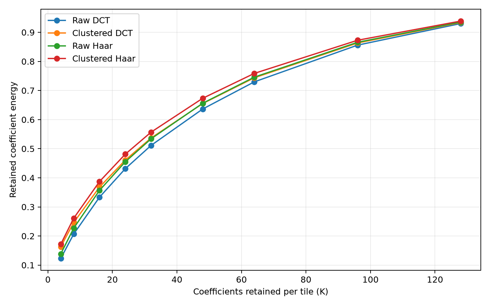
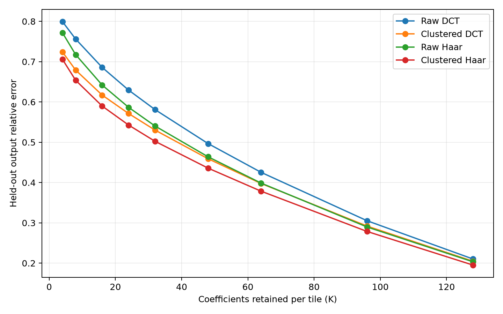
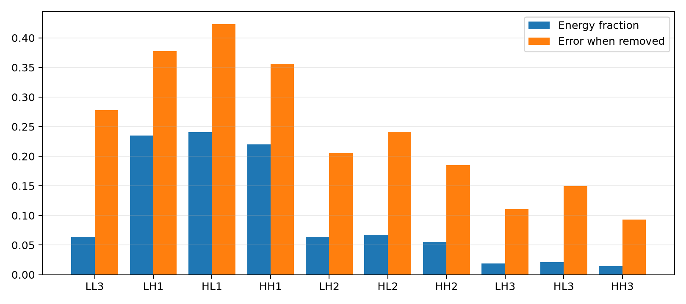
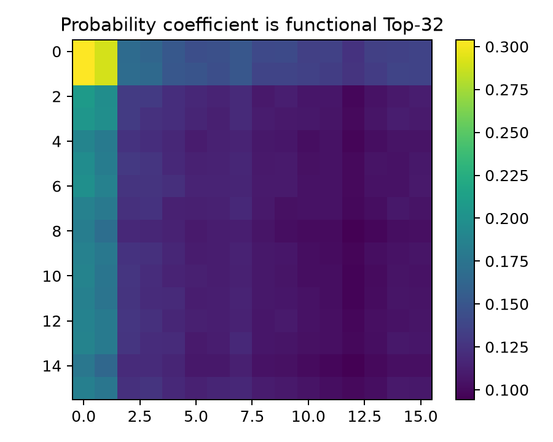
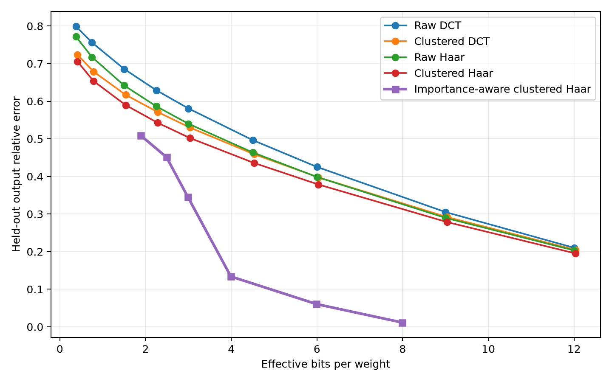
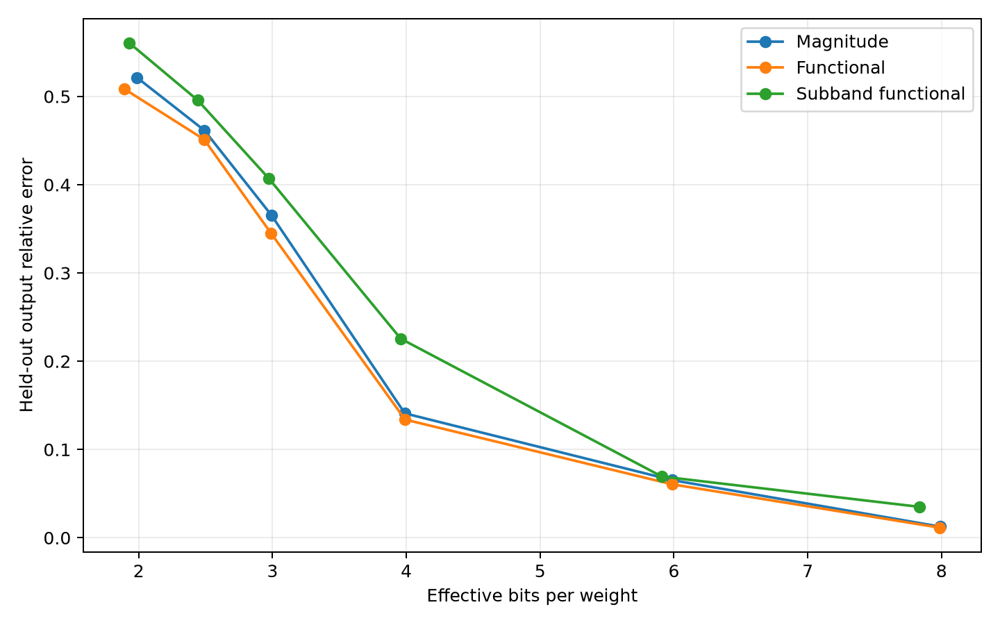

# WaveFly normalized clustering + Haar DWT experiment

## A. Correctness

The implementation uses a separable orthonormal packed Haar transform and recursively transforms only the LL region. Complete coefficients reconstruct the permuted tile, and inverse row/column permutations restore the original matrix. Exact permutation identity was asserted on every layer. Worst observed transform errors:

| dtype | relative_error | max_error | orthogonality |
| --- | --- | --- | --- |
| torch.float32 | 1.03407e-07 | 5.96046e-08 | 3.42285e-08 |
| torch.float64 | 7.9521e-16 | 4.44089e-16 | 6.66134e-16 |

The actual framework orientation was also checked: `nn.Linear` output was reproduced as `XW^T+b`; the worst absolute difference across captured native outputs was 4.57764e-05 (ordinary GPU accumulation-order rounding).

## B. Raw Haar results

At B=16, K=32, and magnitude selection, level-3 raw Haar retained 53.42% energy with 68.16% weight error and 54.02% held-out output error. Functional selection changed held-out error to 48.53%. Results for Haar levels 1, 2, and 3 are retained separately.

## C. Clustered Haar results

The exact prior winner was held fixed: normalized row and column K-means, 16 clusters, centroid-distance ordering. At K=32 magnitude selection, clustering changed level-3 Haar held-out error from 54.02% to 50.22%. With functional selection it changed 48.53% to 45.96%. When each side may choose its best level, raw Haar L1 reaches 45.71% and clustered Haar L2 reaches 45.96%; clustering therefore does not improve the best activation-aware Haar result overall.

Tile-size results at one-eighth coefficient retention on the Qwen middle Q projection:

| tile | bpw | energy | weight_error | test_output_error |
| --- | --- | --- | --- | --- |
| 8 | 2.77264 | 0.473274 | 0.725759 | 0.210488 |
| 32 | 3.27264 | 0.454394 | 0.738652 | 0.181536 |

## D. DCT vs DWT comparison

All figures below average the same 33 matrices and use unseen activation samples for output error. Top-K storage includes FP16 coefficient values, arbitrary within-tile indices, permutation tables, and a 32-byte layer header.

| Method | BPW | Energy_retained | Weight_error | Output_error |
| --- | --- | --- | --- | --- |
| Raw DCT | 3.00067 | 0.511467 | 0.698522 | 0.580825 |
| Clustered DCT | 3.035 | 0.536863 | 0.677442 | 0.530041 |
| Raw Haar | 3.00067 | 0.534221 | 0.681606 | 0.54015 |
| Clustered Haar | 3.035 | 0.557005 | 0.662051 | 0.502209 |
| Clustered Haar + magnitude allocation | 1.9873 | 0.561998 | 0.659801 | 0.521347 |
| Clustered Haar + functional allocation | 1.89071 | 0.498707 | 0.704896 | 0.508663 |

At K=32, clustered Haar functional selection reaches 45.96% error versus 52.17% for clustered DCT functional selection. Haar is better, but both remain far outside useful inference accuracy.

## E. Subband sensitivity

No subband was assumed to be noise. Each row reports its coefficient and energy fractions and the complete held-out layer-output error caused by removing only that band:

| band | coefficient_fraction | energy_fraction | train_removal_error | test_removal_error |
| --- | --- | --- | --- | --- |
| LL3 | 0.015625 | 0.0633885 | 0.277166 | 0.277562 |
| LH1 | 0.25 | 0.235201 | 0.378538 | 0.377733 |
| HL1 | 0.25 | 0.240697 | 0.424092 | 0.423506 |
| HH1 | 0.25 | 0.220054 | 0.358198 | 0.356323 |
| LH2 | 0.0625 | 0.0630568 | 0.203763 | 0.205091 |
| HL2 | 0.0625 | 0.0676233 | 0.244753 | 0.24165 |
| HH2 | 0.0625 | 0.0555089 | 0.184185 | 0.185196 |
| LH3 | 0.015625 | 0.0187695 | 0.110939 | 0.110843 |
| HL3 | 0.015625 | 0.0213892 | 0.151481 | 0.149378 |
| HH3 | 0.015625 | 0.0143112 | 0.0936449 | 0.0929989 |

LL3 occupies only 1.56% of coefficients but its removal causes 27.76% mean output error. High-frequency bands are also functionally important: removing HH1 alone causes 35.63%. Important information is distributed across LL, LH, HL, and HH.

## F. Functional coefficient importance

For coefficient `c[u,v]`, exact isolated linear-output importance is `c[u,v]^2 ||X_tile H[v]^T||^2`; row-basis norm is one. Rankings use calibration activations only. Magnitude and energy selection have identical rankings by definition; their recorded reconstructions agree. Functional ranking improves level-3 clustered Haar K=32 held-out error from 50.22% to 45.96%. Thus magnitude is informative but incomplete.

Top-32 fixed-pattern overlap across layers has mean Jaccard 0.4648 and median 0.4545 over 528 pairs. Some locations repeat, but this overlap is insufficient for one universal lossless importance layout.

## G. BPW vs output-error curves

Mixed precision uses {0,2,4,8,16} bits. It learns a layer-wide 3-bit precision code per wavelet position from calibration importance, so all tiles share the mask and bit layout. It compares per-tile, per-tile/subband, and one-scale-per-16-tiles grouping. Every FP16 scale, allocation code, permutation index, and header is included.

| target_bpw | bpw | allocation | scale_mode | energy_explained | weight_error | train_output_error | test_output_error |
| --- | --- | --- | --- | --- | --- | --- | --- |
| 8 | 7.98683 | functional_fixed | tile | 0.999721 | 0.0166483 | 0.0111266 | 0.0114681 |
| 6 | 5.98683 | functional_fixed | tile | 0.992985 | 0.0834092 | 0.0596067 | 0.0605413 |
| 4 | 3.99086 | functional_fixed | tile | 0.966223 | 0.182794 | 0.132277 | 0.133907 |
| 3 | 2.98896 | functional_fixed | tile | 0.781285 | 0.465772 | 0.340341 | 0.344968 |
| 2.5 | 2.48896 | functional_fixed | tile | 0.652836 | 0.586791 | 0.448199 | 0.451259 |
| 2 | 1.89071 | functional_fixed | subband | 0.498707 | 0.704896 | 0.503219 | 0.508663 |

At or below 2 BPW, the best mean held-out error is 50.87%. At 2.5, 3, 4, 6, and 8 target BPW the best measured errors are 2.5: 45.13%, 3: 34.50%, 4: 13.39%, 6: 6.05%, 8: 1.15%. The 2–3 BPW region remains unusable.

## H. Generalization to held-out activations

The first three calibration passages select functional importance; the final two passages are held out. No held-out activations enter importance ranking or bit allocation.

| target_bpw | bpw | allocation | scale_mode | train_output_error | test_output_error | gap |
| --- | --- | --- | --- | --- | --- | --- |
| 8 | 7.98683 | functional_fixed | tile | 0.0111266 | 0.0114681 | 0.000341559 |
| 6 | 5.98683 | functional_fixed | tile | 0.0596067 | 0.0605413 | 0.000934604 |
| 4 | 3.99086 | functional_fixed | tile | 0.132277 | 0.133907 | 0.00163043 |
| 3 | 2.98896 | functional_fixed | tile | 0.340341 | 0.344968 | 0.00462699 |
| 2.5 | 2.48896 | functional_fixed | tile | 0.448199 | 0.451259 | 0.00305936 |
| 2 | 1.89071 | functional_fixed | subband | 0.503219 | 0.508663 | 0.00544429 |

The small average gaps show that the failure at low BPW is not primarily calibration overfitting.

## I. Metadata cost

| target_bpw | bpw | coefficient_bpw | scale_bpw | allocation_metadata_bpw | permutation_bpw | allocation | scale_mode | nonzero_positions |
| --- | --- | --- | --- | --- | --- | --- | --- | --- |
| 8 | 7.98683 | 7.82481 | 0.125 | 0.00201659 | 0.0343317 | functional_fixed | tile | 256 |
| 6 | 5.98683 | 5.82481 | 0.125 | 0.00201659 | 0.0343317 | functional_fixed | tile | 256 |
| 4 | 3.99086 | 3.81558 | 0.138258 | 0.00201659 | 0.0343317 | functional_fixed | tile | 256 |
| 3 | 2.98896 | 2.81937 | 0.132576 | 0.00201659 | 0.0343317 | functional_fixed | tile | 255.636 |
| 2.5 | 2.48896 | 2.32315 | 0.128788 | 0.00201659 | 0.0343317 | functional_fixed | tile | 252.242 |
| 2 | 1.89071 | 1.14347 | 0.710227 | 0.00201659 | 0.0343317 | functional_fixed | subband | 141.424 |

Arbitrary Top-K stores an index for every retained coefficient. Mixed precision avoids per-tile masks by sharing one position-to-precision pattern across the whole layer. Global row/column permutation overhead is measured per matrix rather than reusing the earlier 0.034-BPW estimate. The mean in each selected rate point appears above. Runtime objects, container filesystem blocks, and entropy coding are excluded.

For the best 2/3/4-BPW functional reconstruction, sparse residual energy capture is:

| budget | density | sparse_energy |
| --- | --- | --- |
| 2 | 0.001 | 0.0402244 |
| 2 | 0.0025 | 0.0695882 |
| 2 | 0.005 | 0.104066 |
| 2 | 0.01 | 0.154652 |
| 2 | 0.02 | 0.227556 |
| 2 | 0.05 | 0.37078 |
| 3 | 0.001 | 0.0302812 |
| 3 | 0.0025 | 0.056936 |
| 3 | 0.005 | 0.0902245 |
| 3 | 0.01 | 0.141246 |
| 3 | 0.02 | 0.217883 |
| 3 | 0.05 | 0.373933 |
| 4 | 0.001 | 0.0417888 |
| 4 | 0.0025 | 0.0747859 |
| 4 | 0.005 | 0.113495 |
| 4 | 0.01 | 0.16928 |
| 4 | 0.02 | 0.247669 |
| 4 | 0.05 | 0.396026 |

Discovery-layer residual structure details:

| layer | budget | density | sparse_energy | residual_kurtosis | rank1_energy | rank4_energy | rank8_energy | rank16_energy | rank32_energy |
| --- | --- | --- | --- | --- | --- | --- | --- | --- | --- |
| Qwen/Qwen2.5-0.5B/model.layers.0.self_attn.q_proj@early | 2 | nan | nan | 25.0839 | 0.0882576 | 0.192606 | 0.27541 | 0.374493 | 0.4945 |

Sparse FP16 residual storage is not added to the claimed rate; prior experiments showed its indices quickly overwhelm the budget.

## J. Estimated inverse-transform complexity

For B=16 and L=3, a dense separable inverse DCT requires approximately 8192 constant multiplications and 7680 additions per tile. A direct orthonormal inverse Haar requires approximately 672 additions/subtractions and 672 scale multiplications; powers of `1/sqrt(2)` may be combined or implemented cheaply. Both require 256 coefficient loads when dense and roughly 256-value working storage before scheduling optimizations. Sparse/mixed coefficient decoding adds loads and dequantization according to the retained representation.

Haar is mathematically cheap enough to remain hardware-interesting if accuracy succeeds. Accuracy at 2–3 BPW did not succeed, so no CUDA/Triton kernel was built.

## K. Final verdict

Normalized clustering + DWT for WaveFly:

FAIL

Measured reasons: clustered Haar improves the K=32 functional error over clustered DCT from 52.17% to 45.96%, but its best level (45.96%) does not improve on the best raw-Haar level (45.71%), and the best complete 2-BPW mixed-precision representation retains 50.87% held-out output error. At 3 BPW it still has 34.50% error. High-frequency subbands demonstrably carry model function and cannot be discarded wholesale.

The measured rate-distortion curve rejects fixed Haar wavelets as the core WaveFly representation for these pretrained weights. The next experiment should move to a learned orthogonal basis/PCA, dictionary learning, or vector/codebook representation, with held-out activation-aware allocation retained as an evaluation tool.

The run covered 33 matrices from Qwen2.5-0.5B, OPT-125M, and Pythia-70M; model/runtime failures: 0. End-to-end perplexity was not measured because the representation failed the layer-accuracy gate.
