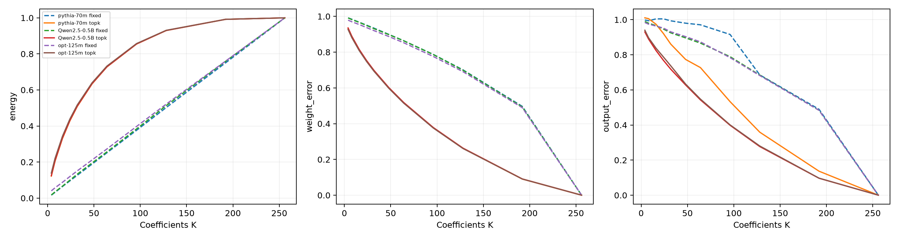
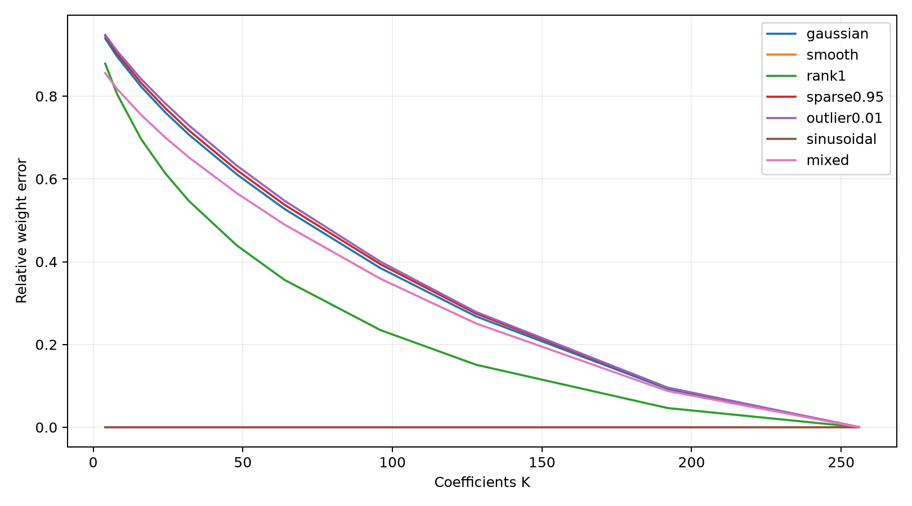
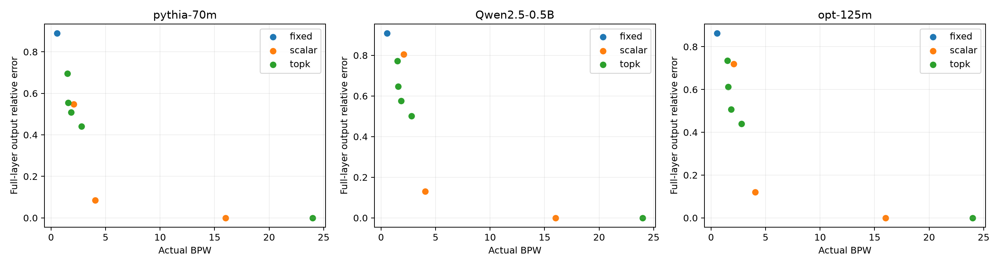
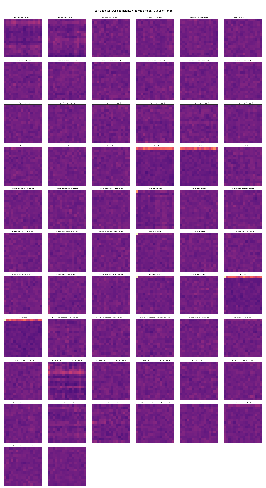

# WaveFly experiments 1–2: numerical proof report

## Verdict

**Storage and reconstruction work; useful general-purpose low-bit DCT compression is not supported by these measurements.** Full-coefficient DCT is numerically reversible. Quantized coefficients and residuals can be physically packed, read, reconstructed, and requantized. These mechanics do not establish acceptable model quality.

- **Gate 1 — Representation: PASS** for the full-coefficient numerical round trip; compact reconstruction is strongly data-dependent.
- **Gate 2 — Universality: FAIL** for the tested fixed-DCT hypothesis across these three small pretrained transformer families. This is a conclusion about this basis, tile layout, and tested codec, not a proof that every wave-based or learned representation fails.
- **Gate 3 — Hardware: NOT TESTED.** The user requested the first two experiments. Assigning PASS/PARTIAL/FAIL without a hardware experiment would misstate the evidence.

## Scope and reproducibility

GPU: NVIDIA A40, 44.43 GiB; PyTorch 2.8.0+cu128; CUDA runtime 12.8; Triton 3.4.0. Seed 20260922; TF32 disabled. CPU details and checkpoint revision hashes are in results/json. The run produced **94,608 configuration measurements**, **702 round-trip measurements**, and **477 full-layer checks**.

Three pretrained models: Qwen/Qwen2.5-0.5B, facebook/opt-125m, EleutherAI/pythia-70m. Early/middle/late layers, attention projections, MLP projections, and embeddings were sampled. Architectures without a gated MLP have no gate projection. GPT-NeoX fused QKV was separated using its head-interleaved layout. Qwen and OPT LM heads were included; Pythia's separately named output head was not sampled. Each matrix/size uses 128 random aligned tiles sampled with replacement. Synthetic families each use 128 tiles per size. Sizes: 8,16,32,64.

Calibration uses five fixed short English passages covering prose, science, arithmetic, and code descriptions. These are a small illustrative calibration set, not a representative benchmark corpus. Tile output metrics measure local partial contributions using actual module input activations; **full-layer measurements additionally reconstruct the whole matrix offline and measure XW^T error**, excluding bias. Embedding tile output uses identity input and is a reconstruction metric, not a language-model activation metric. No perplexity, downstream accuracy, or acceptable-quality threshold was established.

## 1. Numerical representation

Explicit orthonormal DCT-II: C = D W D^T; reconstruction W_hat = D^T C D. Bases are formed in float64 and cast to the tested dtype. Error metrics accumulate in float64. Round trips cover every synthetic family plus real tiles at B=8,16,32. Worst observed errors:

| dtype | orthogonality | max_abs | weight_error | output_error |
| --- | --- | --- | --- | --- |
| torch.float16 | 0.000300765 | 0.03125 | 0.00115441 | 0.00123544 |
| torch.float32 | 7.58762e-08 | 7.62939e-06 | 2.11237e-07 | 2.25647e-07 |
| torch.float64 | 2.01951e-15 | 1.4011e-13 | 5.24484e-15 | 5.75748e-15 |

This is numerical equivalence within the observed errors, not bitwise equality to the original weights. Float16 coefficients and arithmetic introduce additional rounding. Basis construction in float64 avoids conflating low-precision cosine construction with transform multiplication error.

## 2. Compression curves

The B=16 sweep uses K=256,192,128,96,64,48,32,24,16,8,4. Fixed selection is an exact-area low-frequency rectangle, choosing the most square factorization and anchoring at DC. Top-K selects the largest absolute coefficients and pays index costs. Energy is averaged per tile; weight/output relative errors use pooled squared norms.

Synthetic results at K=32, FP16 coefficient storage, top-K, no residual:

| layer | energy | bpw | weight_error | output_error |
| --- | --- | --- | --- | --- |
| gaussian | 0.500208 | 3.00781 | 0.706937 | 0.702791 |
| uniform | 0.503325 | 3.00781 | 0.70472 | 0.705496 |
| smooth | 1 | 3.00781 | 0.000213304 | 0.000213711 |
| rank1 | 0.698962 | 3.00781 | 0.546735 | 0.558193 |
| rank2 | 0.638373 | 3.00781 | 0.600726 | 0.601189 |
| rank4 | 0.583922 | 3.00781 | 0.643896 | 0.65126 |
| rank8 | 0.535087 | 3.00781 | 0.68134 | 0.673017 |
| sparse0.5 | 0.498781 | 3.00781 | 0.708005 | 0.708136 |
| sparse0.75 | 0.495793 | 3.00781 | 0.709435 | 0.710992 |
| sparse0.9 | 0.495733 | 3.00781 | 0.710192 | 0.709985 |
| sparse0.95 | 0.48486 | 3.00781 | 0.717261 | 0.711396 |
| outlier0.001 | 0.496012 | 3.00781 | 0.722056 | 0.724231 |
| outlier0.01 | 0.475901 | 3.00781 | 0.729394 | 0.729555 |
| outlier0.05 | 0.484083 | 3.00781 | 0.716831 | 0.72003 |
| sinusoidal | 1 | 3.00781 | 0.000201697 | 0.000201485 |
| mixed | 0.607971 | 3.00781 | 0.651948 | 0.646455 |

Smooth and deliberately DCT-aligned signals compress well. Low rank by itself does not guarantee a sparse DCT spectrum. Random and spatially sparse matrices are important negative controls.

## 3. Full-layer output and storage comparison

The following summaries average layer-relative errors within each model. Full per-layer rows are in results/csv/full_layers.csv, avoiding reliance on one aggregate. Integer scalar baselines use symmetric mid-rise levels with one FP16 scale per 256-weight tile (four levels for 2-bit). They are simple baselines, not GPTQ/AWQ or optimized learned quantizers. FP16 baseline casts weights to FP16 then evaluates in FP32. All coefficient tests use FP32 transform math unless the round-trip dtype test says otherwise.

| model | method | k | bits | residual_count | bpw | weight_error | output_error |
| --- | --- | --- | --- | --- | --- | --- | --- |
| EleutherAI/pythia-70m | fixed | 32 | 4 | 0 | 0.562948 | 0.934259 | 0.888881 |
| EleutherAI/pythia-70m | scalar | 256 | 2 | 0 | 2.06295 | 0.714428 | 0.548428 |
| EleutherAI/pythia-70m | scalar | 256 | 4 | 0 | 4.06295 | 0.133021 | 0.0852021 |
| EleutherAI/pythia-70m | scalar | 256 | 16 | 0 | 16.0004 | 0 | 0 |
| EleutherAI/pythia-70m | topk | 16 | 16 | 0 | 1.50045 | 0.810356 | 0.695334 |
| EleutherAI/pythia-70m | topk | 32 | 4 | 0 | 1.56295 | 0.693647 | 0.554583 |
| EleutherAI/pythia-70m | topk | 32 | 4 | 3 | 1.8442 | 0.658295 | 0.508862 |
| EleutherAI/pythia-70m | topk | 32 | 4 | 13 | 2.7817 | 0.584824 | 0.441416 |
| EleutherAI/pythia-70m | topk | 256 | 16 | 0 | 24.0004 | 0.000207331 | 0.000128904 |
| Qwen/Qwen2.5-0.5B | fixed | 32 | 4 | 0 | 0.56322 | 0.93362 | 0.908107 |
| Qwen/Qwen2.5-0.5B | scalar | 256 | 2 | 0 | 2.06322 | 0.853538 | 0.804498 |
| Qwen/Qwen2.5-0.5B | scalar | 256 | 4 | 0 | 4.06322 | 0.151947 | 0.12988 |
| Qwen/Qwen2.5-0.5B | scalar | 256 | 16 | 0 | 16.0007 | 1.92923e-08 | 2.43072e-08 |
| Qwen/Qwen2.5-0.5B | topk | 16 | 16 | 0 | 1.50072 | 0.81692 | 0.772436 |
| Qwen/Qwen2.5-0.5B | topk | 32 | 4 | 0 | 1.56322 | 0.700903 | 0.646188 |
| Qwen/Qwen2.5-0.5B | topk | 32 | 4 | 3 | 1.84447 | 0.661596 | 0.575418 |
| Qwen/Qwen2.5-0.5B | topk | 32 | 4 | 13 | 2.78197 | 0.584696 | 0.500701 |
| Qwen/Qwen2.5-0.5B | topk | 256 | 16 | 0 | 24.0007 | 0.000207398 | 0.000173112 |
| facebook/opt-125m | fixed | 32 | 4 | 0 | 0.562809 | 0.927225 | 0.86232 |
| facebook/opt-125m | scalar | 256 | 2 | 0 | 2.06281 | 0.891167 | 0.719993 |
| facebook/opt-125m | scalar | 256 | 4 | 0 | 4.06281 | 0.156524 | 0.1203 |
| facebook/opt-125m | scalar | 256 | 16 | 0 | 16.0003 | 0 | 0 |
| facebook/opt-125m | topk | 16 | 16 | 0 | 1.50031 | 0.814857 | 0.734345 |
| facebook/opt-125m | topk | 32 | 4 | 0 | 1.56281 | 0.700367 | 0.61182 |
| facebook/opt-125m | topk | 32 | 4 | 3 | 1.84406 | 0.659201 | 0.506843 |
| facebook/opt-125m | topk | 32 | 4 | 13 | 2.78156 | 0.583211 | 0.439676 |
| facebook/opt-125m | topk | 256 | 16 | 0 | 24.0003 | 0.000207409 | 0.000153171 |

Best **tile-level** configurations under 2.1 BPW are saved per model/layer in best_under_2_1_bpw.csv. This is an in-sample sweep selection, not held-out validation. Model-level range of those layer errors:

| model | min | median | max |
| --- | --- | --- | --- |
| EleutherAI/pythia-70m | 0.124756 | 0.585771 | 0.765741 |
| Qwen/Qwen2.5-0.5B | 0.200916 | 0.543093 | 0.645519 |
| facebook/opt-125m | 0.349588 | 0.516798 | 0.694584 |

The hybrid K=32 INT4 codec with three residuals does beat this simple 2-bit scalar baseline on mean full-layer output error in all three models, while using about 1.844 rather than 2.063 BPW. This is a positive relative result, but its roughly 51–58% output error is still large; no end-to-end quality claim follows. INT4 scalar uses more storage (about 4.063 BPW) and has much lower mean output error (about 8.5–13%).

## 4. Residuals, quantization, and actual serialization

B=16 tests FP16/INT8/INT4/2-bit spectral values, magnitude and activation-weighted residual selection on real matrices, and requested densities 0,0.1,0.25,0.5,1,2,5%. Residual slots use round(density*B^2): at B=16 these are **0,0,1,1,3,5,13 slots**, so requested sub-tile fractions are not all distinct. Actual density is recorded. Residual values are FP16. Importance is |R[out,in]| times mean absolute input activation for that input coordinate. This is a heuristic, not an optimal correction.

Every serialized tensor has a 32-byte header. Each tile stores a byte-aligned packed coefficient stream, top-K indices if needed (ceil(log2(B^2)) bits/index), FP16 residual values, packed residual indices, and a two-byte scale for integer coefficients. Fixed K and residual count are tensor-wide and recorded in the header. Fixed masks are derived from geometry and consume no per-tile index stream. The constant DCT basis is shared implementation data rather than weight payload; cached basis RAM and inference traffic are not measured here. No entropy coding, file-system blocks, runtime tensor-object overhead, or model-container overhead is included. Reported BPW is this concrete tile-tensor codec's payload, not end-to-end model file size.

At B=16, K=32, INT4, top-K and 3 residuals: coefficients=16 bytes/tile, indices=32, residuals=6, residual indices=3, scale=2 => 59 bytes/tile, or **1.84375 BPW plus the tensor header**. Fixed K=32 INT4 with no residual is 18 bytes/tile (0.5625 BPW plus header), but dropping more information produces high error. FP16 K=32 top-K costs 3 BPW before header.

All 8 sampled serialization tests reproduced the corresponding simulated reconstructions exactly; a separate test passed 32 combinations across four tile sizes, two selection modes, and four coefficient precisions, including packed residual indices. This verifies the implementation and byte accounting, not model accuracy.

Real pretrained tiles were also written, read, and successively requantized through FP16 → INT8 → INT4 → 2-bit. These are single-tile files, so their 32-byte header adds 1 BPW; numbers should not be compared directly to large-tensor amortized BPW. Requantization does not restore information already removed by top-K selection:

| model | bits | bytes | bpw | weight_error | output_error |
| --- | --- | --- | --- | --- | --- |
| Qwen/Qwen2.5-0.5B | 16 | 128 | 4 | 0.628177 | 0.506209 |
| Qwen/Qwen2.5-0.5B | 8 | 98 | 3.0625 | 0.628181 | 0.506154 |
| Qwen/Qwen2.5-0.5B | 4 | 82 | 2.5625 | 0.629598 | 0.51162 |
| Qwen/Qwen2.5-0.5B | 2 | 74 | 2.3125 | 0.681304 | 0.548005 |
| facebook/opt-125m | 16 | 128 | 4 | 0.718404 | 0.743309 |
| facebook/opt-125m | 8 | 98 | 3.0625 | 0.718414 | 0.743457 |
| facebook/opt-125m | 4 | 82 | 2.5625 | 0.720438 | 0.747727 |
| facebook/opt-125m | 2 | 74 | 2.3125 | 0.750601 | 0.772384 |
| EleutherAI/pythia-70m | 16 | 128 | 4 | 0.68817 | 0.62594 |
| EleutherAI/pythia-70m | 8 | 98 | 3.0625 | 0.688179 | 0.625585 |
| EleutherAI/pythia-70m | 4 | 82 | 2.5625 | 0.690483 | 0.631536 |
| EleutherAI/pythia-70m | 2 | 74 | 2.3125 | 0.721136 | 0.685175 |

## 5. Tile-size sweep and coefficient structure

Other tile sizes sweep retained fractions 1,3/4,1/2,1/4,1/8,1/16, FP16 coefficients, and residual requests 0,1,5%. The full coefficient-precision/residual Cartesian sweep is B=16 only. At one-eighth retention, top-K, FP16 and zero residual:

| model | tile | bpw | energy | weight_error | output_error | idct_flops_per_tile |
| --- | --- | --- | --- | --- | --- | --- |
| EleutherAI/pythia-70m | 8 | 2.78125 | 0.497046 | 0.704234 | 0.83902 | 2048 |
| EleutherAI/pythia-70m | 16 | 3.00781 | 0.50853 | 0.694936 | 0.860547 | 16384 |
| EleutherAI/pythia-70m | 32 | 3.25195 | 0.509124 | 0.696705 | 0.845322 | 131072 |
| EleutherAI/pythia-70m | 64 | 3.50049 | 0.51092 | 0.695404 | 0.828456 | 1.04858e+06 |
| Qwen/Qwen2.5-0.5B | 8 | 2.78125 | 0.503004 | 0.704647 | 0.703191 | 2048 |
| Qwen/Qwen2.5-0.5B | 16 | 3.00781 | 0.510372 | 0.697699 | 0.717688 | 16384 |
| Qwen/Qwen2.5-0.5B | 32 | 3.25195 | 0.512832 | 0.698012 | 0.710543 | 131072 |
| Qwen/Qwen2.5-0.5B | 64 | 3.50049 | 0.512994 | 0.696866 | 0.699455 | 1.04858e+06 |
| facebook/opt-125m | 8 | 2.78125 | 0.506273 | 0.70123 | 0.743264 | 2048 |
| facebook/opt-125m | 16 | 3.00781 | 0.516665 | 0.693015 | 0.73671 | 16384 |
| facebook/opt-125m | 32 | 3.25195 | 0.520074 | 0.690524 | 0.671906 | 131072 |
| facebook/opt-125m | 64 | 3.50049 | 0.521875 | 0.689361 | 0.651365 | 1.04858e+06 |

Dense separable IDCT costs approximately 4B^3 floating-point operations per tile (two multiplies, counting multiply-add as two). Direct sparse synthesis has different arithmetic and was not timed. These operation counts are not hardware performance estimates.

Each heatmap is mean absolute coefficient magnitude over the sampled tiles, normalized by its own mean. Colors share a 0–3 range. The raw heatmaps are saved as NPY arrays. Predictable low-frequency concentration is insufficient here to make the tested compact fixed masks competitive across the tested layers.

## 6. Per-type and layer-position breakdown

K=32, top-K, FP16 spectral storage, no residual. Full raw grids and per-layer baseline/hybrid comparisons are in measurements.csv and full_layers.csv.

| model | type | stage | energy | bpw | weight_error | output_error |
| --- | --- | --- | --- | --- | --- | --- |
| EleutherAI/pythia-70m | attention_output | early | 0.501283 | 3.00781 | 0.705208 | 0.632841 |
| EleutherAI/pythia-70m | attention_output | late | 0.506107 | 3.00781 | 0.703521 | 0.587335 |
| EleutherAI/pythia-70m | attention_output | middle | 0.501132 | 3.00781 | 0.706567 | 0.708454 |
| EleutherAI/pythia-70m | dense_4h_to_h | early | 0.50585 | 3.00781 | 0.703335 | 0.696446 |
| EleutherAI/pythia-70m | dense_4h_to_h | late | 0.504723 | 3.00781 | 0.702909 | 0.828747 |
| EleutherAI/pythia-70m | dense_4h_to_h | middle | 0.50793 | 3.00781 | 0.700318 | 0.781491 |
| EleutherAI/pythia-70m | dense_h_to_4h | early | 0.501187 | 3.00781 | 0.706095 | 0.527761 |
| EleutherAI/pythia-70m | dense_h_to_4h | late | 0.500746 | 3.00781 | 0.706251 | 0.748216 |
| EleutherAI/pythia-70m | dense_h_to_4h | middle | 0.501973 | 3.00781 | 0.705432 | 0.722454 |
| EleutherAI/pythia-70m | embedding | embedding | 0.503004 | 3.00781 | 0.704762 | 0.704762 |
| EleutherAI/pythia-70m | k_proj | early | 0.508944 | 3.00781 | 0.700178 | 0.667565 |
| EleutherAI/pythia-70m | k_proj | late | 0.510664 | 3.00781 | 0.695794 | 2.57245 |
| EleutherAI/pythia-70m | k_proj | middle | 0.51349 | 3.00781 | 0.696188 | 0.673408 |
| EleutherAI/pythia-70m | q_proj | early | 0.510825 | 3.00781 | 0.701618 | 0.703043 |
| EleutherAI/pythia-70m | q_proj | late | 0.534752 | 3.00781 | 0.672161 | 0.456602 |
| EleutherAI/pythia-70m | q_proj | middle | 0.543832 | 3.00781 | 0.5781 | 0.496619 |
| EleutherAI/pythia-70m | v_proj | early | 0.501387 | 3.00781 | 0.704678 | 0.726604 |
| EleutherAI/pythia-70m | v_proj | late | 0.501685 | 3.00781 | 0.706294 | 2.29035 |
| EleutherAI/pythia-70m | v_proj | middle | 0.502558 | 3.00781 | 0.704377 | 0.825246 |
| Qwen/Qwen2.5-0.5B | down_proj | early | 0.495257 | 3.00781 | 0.709954 | 0.698535 |
| Qwen/Qwen2.5-0.5B | down_proj | late | 0.500295 | 3.00781 | 0.706812 | 0.869592 |
| Qwen/Qwen2.5-0.5B | down_proj | middle | 0.497421 | 3.00781 | 0.7091 | 0.708726 |
| Qwen/Qwen2.5-0.5B | embedding | embedding | 0.544812 | 3.00781 | 0.674711 | 0.674711 |
| Qwen/Qwen2.5-0.5B | gate_proj | early | 0.501257 | 3.00781 | 0.706342 | 0.70093 |
| Qwen/Qwen2.5-0.5B | gate_proj | late | 0.499999 | 3.00781 | 0.707042 | 0.708168 |
| Qwen/Qwen2.5-0.5B | gate_proj | middle | 0.498302 | 3.00781 | 0.707736 | 0.701019 |
| Qwen/Qwen2.5-0.5B | k_proj | early | 0.540771 | 3.00781 | 0.673049 | 0.590303 |
| Qwen/Qwen2.5-0.5B | k_proj | late | 0.513274 | 3.00781 | 0.700586 | 0.712793 |
| Qwen/Qwen2.5-0.5B | k_proj | middle | 0.502942 | 3.00781 | 0.705229 | 0.690449 |
| Qwen/Qwen2.5-0.5B | lm_head | head | 0.548749 | 3.00781 | 0.671162 | 0.507232 |
| Qwen/Qwen2.5-0.5B | o_proj | early | 0.509521 | 3.00781 | 0.700509 | 0.685913 |
| Qwen/Qwen2.5-0.5B | o_proj | late | 0.505667 | 3.00781 | 0.702813 | 0.74514 |
| Qwen/Qwen2.5-0.5B | o_proj | middle | 0.505255 | 3.00781 | 0.701925 | 0.698813 |
| Qwen/Qwen2.5-0.5B | q_proj | early | 0.554501 | 3.00781 | 0.625332 | 0.534601 |
| Qwen/Qwen2.5-0.5B | q_proj | late | 0.504224 | 3.00781 | 0.707665 | 0.928849 |
| Qwen/Qwen2.5-0.5B | q_proj | middle | 0.506561 | 3.00781 | 0.701958 | 0.746306 |
| Qwen/Qwen2.5-0.5B | up_proj | early | 0.50029 | 3.00781 | 0.706774 | 0.75764 |
| Qwen/Qwen2.5-0.5B | up_proj | late | 0.499648 | 3.00781 | 0.70705 | 0.760839 |
| Qwen/Qwen2.5-0.5B | up_proj | middle | 0.501696 | 3.00781 | 0.705991 | 0.781754 |
| Qwen/Qwen2.5-0.5B | v_proj | early | 0.500163 | 3.00781 | 0.706939 | 0.801031 |
| Qwen/Qwen2.5-0.5B | v_proj | late | 0.509841 | 3.00781 | 0.699802 | 0.659938 |
| Qwen/Qwen2.5-0.5B | v_proj | middle | 0.498102 | 3.00781 | 0.708591 | 0.843548 |
| facebook/opt-125m | embedding | embedding | 0.633819 | 3.00781 | 0.597587 | 0.597587 |
| facebook/opt-125m | fc1 | early | 0.507074 | 3.00781 | 0.687211 | 0.696463 |
| facebook/opt-125m | fc1 | late | 0.513316 | 3.00781 | 0.697509 | 0.707204 |
| facebook/opt-125m | fc1 | middle | 0.51023 | 3.00781 | 0.699539 | 0.803778 |
| facebook/opt-125m | fc2 | early | 0.504171 | 3.00781 | 0.704033 | 1.63201 |
| facebook/opt-125m | fc2 | late | 0.496393 | 3.00781 | 0.709946 | 0.650631 |
| facebook/opt-125m | fc2 | middle | 0.503766 | 3.00781 | 0.704644 | 0.910931 |
| facebook/opt-125m | k_proj | early | 0.517777 | 3.00781 | 0.695609 | 0.590229 |
| facebook/opt-125m | k_proj | late | 0.500994 | 3.00781 | 0.706681 | 0.661574 |
| facebook/opt-125m | k_proj | middle | 0.497755 | 3.00781 | 0.708796 | 0.635248 |
| facebook/opt-125m | lm_head | head | 0.631785 | 3.00781 | 0.599503 | 0.465414 |
| facebook/opt-125m | out_proj | early | 0.50409 | 3.00781 | 0.709088 | 0.655727 |
| facebook/opt-125m | out_proj | late | 0.503375 | 3.00781 | 0.691492 | 0.701184 |
| facebook/opt-125m | out_proj | middle | 0.495877 | 3.00781 | 0.709544 | 0.715178 |
| facebook/opt-125m | q_proj | early | 0.51376 | 3.00781 | 0.704552 | 0.665474 |
| facebook/opt-125m | q_proj | late | 0.50601 | 3.00781 | 0.702114 | 0.67202 |
| facebook/opt-125m | q_proj | middle | 0.494544 | 3.00781 | 0.710633 | 0.65998 |
| facebook/opt-125m | v_proj | early | 0.50011 | 3.00781 | 0.706107 | 0.704139 |
| facebook/opt-125m | v_proj | late | 0.496806 | 3.00781 | 0.709956 | 0.761198 |
| facebook/opt-125m | v_proj | middle | 0.501648 | 3.00781 | 0.705749 | 0.848235 |

## Limitations and next decision

No experiment 3 kernel, on-chip reconstruction, timing, throughput, or Tensor Core claim is made. Offline reconstruction intentionally materializes weights for numerical comparisons; it is not the proposed inference implementation. Three small models do not establish behavior of all larger LLMs. Original checkpoint precision limits the source information; loading in FP32 does not increase that information. Tile sampling, short calibration, basic scalar quantizers, and fixed per-tile residual budgets limit generality. Real outlier-heavy layers were not separately classified; synthetic outlier densities were covered.

The initial model-download attempt failed because the pod enabled hf_transfer without installing it. Rerunning with HF_HUB_ENABLE_HF_TRANSFER=0 resolved it. Final model-load failures: 0. Logs are retained.

**Decision:** do not proceed on the assumption that this fixed-DCT codec gives generally useful approximately 2-BPW LLM weights. Investigate adaptive or learned bases, channel permutations, or a fallback scalar representation. Define a held-out model-quality target before spending effort on a fused kernel. Successful storage/requantization is proven as an implementation operation; quality-preserving aggressive compression is not.
