# WaveFly V4: saliency-protected columns and grouped bulk compression

## A. Previous baseline

The unchanged clustered-Haar mixed-precision baseline produced 50.87% held-out layer-output error near 2 BPW, 45.13% near 2.5 BPW, 34.50% near 3 BPW, and 13.39% near 4 BPW. V4 reuses the same 33 matrices, models, layer selection, token texts, train/held-out split, `nn.Linear` orientation, and metrics. Native `XW^T+b` verification had worst absolute difference 4.57764e-05. Runtime failures: 0.

## B. Functional saliency analysis

For column j, direct removal damage is exactly `sum(X_j^2) * ||W[:,j]||_2^2` for this linear-output metric. Therefore direct functional damage and weight×activation produce identical rankings; this is a mathematical identity, not a missing experiment. Activation RMS, weight norm, and their product were measured separately.

Mean rank correlations:

| a | b | value |
| --- | --- | --- |
| activation_rms | functional | 0.923162 |
| activation_rms | weight_norm | -0.165207 |
| activation_rms | weight_x_activation | 0.923162 |
| functional | weight_norm | 0.10091 |
| functional | weight_x_activation | 1 |
| weight_norm | weight_x_activation | 0.10091 |

Best configuration below 2.5 BPW for each independently ranked metric:

| saliency_metric | salient_fraction | salient_precision | bulk_transform | group_size | bulk_bits | bpw | error |
| --- | --- | --- | --- | --- | --- | --- | --- |
| activation_rms | 0.05 | 8 | none | 32 | 2 | 2.39731 | 0.2233 |
| functional | 0.05 | 8 | none | 32 | 2 | 2.39731 | 0.225464 |
| weight_norm | 0.05 | 8 | none | 32 | 2 | 2.39731 | 0.287266 |

Activation RMS wins this grid. The functional product overweights high-norm columns relative to the best observed compression behavior, while weight norm alone is worst.

## C. Saliency concentration

| fraction | mean | median | min | max |
| --- | --- | --- | --- | --- |
| 0.005 | 0.230707 | 0.190955 | 0.0275226 | 0.644696 |
| 0.01 | 0.309087 | 0.255924 | 0.0438793 | 0.760564 |
| 0.02 | 0.37923 | 0.335409 | 0.0672179 | 0.779349 |
| 0.025 | 0.402447 | 0.364316 | 0.0779283 | 0.784714 |
| 0.05 | 0.48542 | 0.448401 | 0.120734 | 0.859717 |

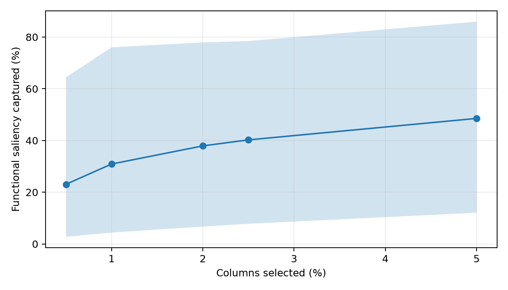

The top 5% of columns contain 48.54% of direct functional saliency. Protecting the activation-RMS top 5% prevents 50.68% of squared output damage from the matched 1.5-bit bulk codec. Saliency helps materially, but damage is not concentrated into only 0.5–1% of columns.

Cross-input salient-set stability:

| fraction | pair | jaccard | overlap |
| --- | --- | --- | --- |
| 0.005 | A-B | 0.429041 | 0.557323 |
| 0.005 | A-C | 0.510557 | 0.614141 |
| 0.005 | B-C | 0.448335 | 0.548485 |
| 0.01 | A-B | 0.459384 | 0.586178 |
| 0.01 | A-C | 0.512716 | 0.642646 |
| 0.01 | B-C | 0.496787 | 0.612165 |
| 0.02 | A-B | 0.432484 | 0.580687 |
| 0.02 | A-C | 0.50542 | 0.643745 |
| 0.02 | B-C | 0.418806 | 0.566003 |
| 0.025 | A-B | 0.444049 | 0.590817 |
| 0.025 | A-C | 0.495348 | 0.636632 |
| 0.025 | B-C | 0.420519 | 0.566175 |
| 0.05 | A-B | 0.430265 | 0.580021 |
| 0.05 | A-C | 0.483861 | 0.629518 |
| 0.05 | B-C | 0.418931 | 0.563178 |

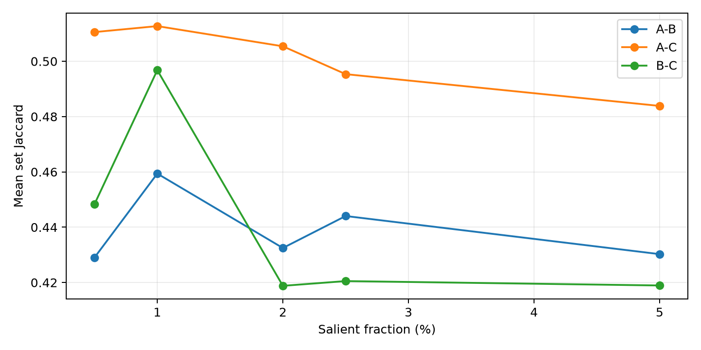

Cross-layer reuse, restricted to the same model and input width:

| fraction | jaccard | overlap |
| --- | --- | --- |
| 0.005 | 0.0991071 | 0.141572 |
| 0.01 | 0.151428 | 0.215141 |
| 0.02 | 0.176522 | 0.258135 |
| 0.025 | 0.167163 | 0.247335 |
| 0.05 | 0.180451 | 0.271197 |

## D. Mixed-precision salient path

Protected values use per-column FP16 scales for INT4/INT8 and no scale for FP16. Column locations use the smaller of an explicit index list and a bitmask, plus one representation flag bit.

| salient_precision | bpw | error | worst |
| --- | --- | --- | --- |
| 4 | 1.75146 | 0.324651 | 0.996594 |
| 8 | 1.95209 | 0.27548 | 0.578602 |
| 16 | 2.3515 | 0.27538 | 0.577895 |

INT8 is the minimum sensible protected precision in this grid: FP16 adds storage with negligible benefit, while INT4 loses more function. The best observed fraction is 5%, the upper boundary tested, so this experiment does not claim a global optimum beyond 5%.

Structured groups of salient columns were tested on the discovery layer:

| salient_block | bpw | test_output_error |
| --- | --- | --- |
| 4 | 1.76698 | 0.0212992 |
| 8 | 1.80278 | 0.0297099 |
| 16 | 1.8459 | 0.025879 |

Arbitrary columns remained better enough to retain as the main path; structured protection trades index regularity for extra or less-targeted protected values.

## E. Haar bulk path

The critical architectural controls use the same activation-RMS 5% salient set, INT8 salient values, 1.5-bit bulk target, G=32, FP8 scales shared across four groups, and MSE scale optimization:

| Method | BPW | Held_out_output_error |
| --- | --- | --- |
| Previous Haar | 1.89071 | 0.508663 |
| Previous Haar | 2.48896 | 0.451259 |
| Previous Haar | 2.98896 | 0.344968 |
| Previous Haar | 3.99086 | 0.133907 |
| Simple groupwise scalar 2-bit | 2.09767 | 0.338906 |
| Saliency only | 0.438256 | 0.65709 |
| Saliency + group quant | 1.95209 | 0.27548 |
| Saliency + Haar | 1.97167 | 0.298561 |
| Saliency + Haar + grouping | 1.97167 | 0.282326 |

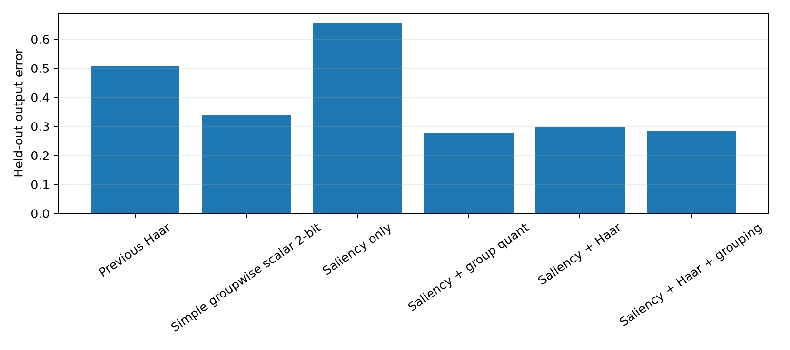

Direct raw-weight group quantization beats both Haar controls. After saliency protection, Haar does not contribute enough and should be removed from the leading design.

## F. Frequency-aware grouping

The validation grid compares G=32 and G=64; discovery additionally tests G=16 and G=128, contiguous groups, subband groups, and shared importance ordering.

Validation trade-off for the winning raw bulk path:

| group_size | bpw | error | scale_bpw |
| --- | --- | --- | --- |
| 32 | 1.95209 | 0.27548 | 0.0593799 |
| 64 | 1.90756 | 0.282213 | 0.0296921 |

Discovery best by group size:

| group_size | bulk_bits | grouping_scheme | scale_precision | scale_share | scale_opt | bpw | error | scale_bpw |
| --- | --- | --- | --- | --- | --- | --- | --- | --- |
| 16 | 2 | contiguous | fp16 | 1 | functional | 3.13023 | 0.0108184 | 0.982143 |
| 32 | 2 | subband | fp8 | 1 | functional | 2.39362 | 0.0155538 | 0.245536 |
| 64 | 2 | subband | fp16 | 1 | functional | 2.39362 | 0.0184955 | 0.245536 |
| 128 | 2 | subband | fp8 | 1 | functional | 2.20947 | 0.019356 | 0.0613839 |

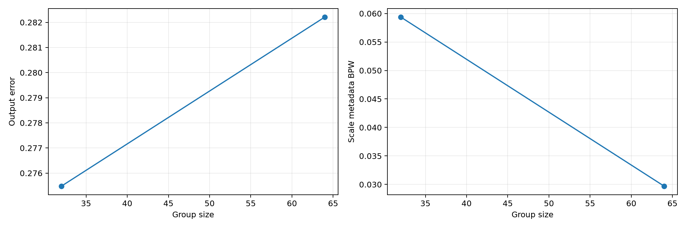

For Haar bulk, subband grouping and fixed within-band importance ordering were counted explicitly. They did not beat the raw G=32 path across validation layers.

Wavelet subband energy and functional importance before/after saliency removal:

| salient_fraction | band | energy_fraction | functional_importance_fraction |
| --- | --- | --- | --- |
| 0 | HH1 | 0.220055 | 0.192407 |
| 0 | HH2 | 0.0555092 | 0.0520912 |
| 0 | HH3 | 0.0143112 | 0.0139248 |
| 0 | HL1 | 0.240697 | 0.249848 |
| 0 | HL2 | 0.0676232 | 0.0753094 |
| 0 | HL3 | 0.0213892 | 0.0259901 |
| 0 | LH1 | 0.2352 | 0.218449 |
| 0 | LH2 | 0.0630569 | 0.0672818 |
| 0 | LH3 | 0.0187695 | 0.0216995 |
| 0 | LL3 | 0.0633885 | 0.0829991 |
| 0.02 | HH1 | 0.220621 | 0.207379 |
| 0.02 | HH2 | 0.0555083 | 0.0541117 |
| 0.02 | HH3 | 0.0143701 | 0.0141608 |
| 0.02 | HL1 | 0.242927 | 0.249944 |
| 0.02 | HL2 | 0.0669837 | 0.0721611 |
| 0.02 | HL3 | 0.0218663 | 0.0250978 |
| 0.02 | LH1 | 0.23505 | 0.221991 |
| 0.02 | LH2 | 0.0627059 | 0.0610227 |
| 0.02 | LH3 | 0.0183702 | 0.0180808 |
| 0.02 | LL3 | 0.0615975 | 0.0760506 |
| 0.05 | HH1 | 0.221015 | 0.210217 |
| 0.05 | HH2 | 0.0556412 | 0.0547985 |
| 0.05 | HH3 | 0.0143362 | 0.0142479 |
| 0.05 | HL1 | 0.241931 | 0.248423 |
| 0.05 | HL2 | 0.066588 | 0.0703762 |
| 0.05 | HL3 | 0.0241583 | 0.026499 |
| 0.05 | LH1 | 0.235741 | 0.224063 |
| 0.05 | LH2 | 0.063095 | 0.062036 |
| 0.05 | LH3 | 0.0181777 | 0.0178877 |
| 0.05 | LL3 | 0.0593159 | 0.0714517 |

Protecting salient columns changes coefficient statistics only modestly rather than turning the remaining wavelet details into disposable noise.

## G. Scale/metadata cost

Each group or shared group bundle stores one scale. FP16 costs 16 bits; simulated E4M3 FP8 costs 8 bits. Non-integer average bulk precision stores one bitwidth flag per base group. Permutations, saliency masks/indices, scale values, wave ordering, and headers are included.

Discovery scale-sharing ablation:

| group_size | bulk_bits | grouping_scheme | scale_precision | scale_share | scale_opt | bpw | error | scale_bpw |
| --- | --- | --- | --- | --- | --- | --- | --- | --- |
| 16 | 2 | contiguous | fp16 | 1 | functional | 3.13023 | 0.0108184 | 0.982143 |
| 16 | 2 | subband | fp16 | 2 | functional | 2.63916 | 0.0157587 | 0.491071 |
| 16 | 1.75 | subband | fp16 | 4 | functional | 2.20947 | 0.0183564 | 0.245536 |
| 16 | 1.75 | subband | fp16 | 8 | functional | 2.0867 | 0.0195249 | 0.122768 |
| 16 | 2 | contiguous | fp8 | 1 | functional | 2.63916 | 0.0108982 | 0.491071 |
| 16 | 2 | subband | fp8 | 2 | functional | 2.39362 | 0.0155538 | 0.245536 |
| 16 | 1.75 | subband | fp8 | 4 | functional | 2.0867 | 0.0184458 | 0.122768 |
| 16 | 1.75 | subband | fp8 | 8 | functional | 2.02532 | 0.0190446 | 0.0613839 |

Ternary discovery result:

| bpw | test_output_error |
| --- | --- |
| 2.20947 | 0.030087 |

Distribution diagnostics:

| salient_fraction | variance | kurtosis | max_mean | outlier_fraction |
| --- | --- | --- | --- | --- |
| 0 | 0.00183369 | 25.8062 | 26.6676 | 0.00692282 |
| 0.02 | 0.00179289 | 23.6376 | 24.6002 | 0.00681084 |
| 0.05 | 0.00174156 | 23.2734 | 23.636 | 0.00677598 |

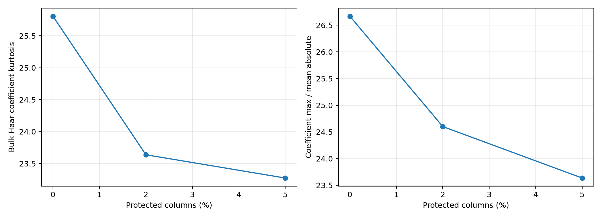

## H. True BPW calculation

Best measured configurations at or below each requested budget:

| budget | bpw | saliency_metric | salient_fraction | salient_precision | bulk_transform | group_size | bulk_bits | scale_precision | scale_share | error | worst |
| --- | --- | --- | --- | --- | --- | --- | --- | --- | --- | --- | --- |
| 1.5 | 1.44747 | activation_rms | 0.05 | 8 | none | 32 | 1 | fp8 | 4 | 0.382943 | 0.709247 |
| 1.75 | 1.7429 | activation_rms | 0.025 | 8 | none | 64 | 1.5 | fp8 | 4 | 0.298836 | 0.619372 |
| 2 | 1.95209 | activation_rms | 0.05 | 8 | none | 32 | 1.5 | fp8 | 4 | 0.27548 | 0.578602 |
| 2.25 | 2.24573 | activation_rms | 0.025 | 8 | none | 32 | 2 | fp8 | 4 | 0.239572 | 0.498327 |
| 2.5 | 2.39731 | activation_rms | 0.05 | 8 | none | 32 | 2 | fp8 | 4 | 0.2233 | 0.457531 |
| 3 | 2.79672 | activation_rms | 0.05 | 16 | none | 32 | 2 | fp8 | 4 | 0.223185 | 0.456669 |
| 4 | 2.79672 | activation_rms | 0.05 | 16 | none | 32 | 2 | fp8 | 4 | 0.223185 | 0.456669 |

For the ≤2-BPW winner, mean storage components are:

| bulk_code_bpw | scale_bpw | salient_value_bpw | salient_index_bpw | permutation_bpw | bpw |
| --- | --- | --- | --- | --- | --- |
| 1.42477 | 0.0593799 | 0.401244 | 0.0011567 | 0.0331834 | 1.95209 |

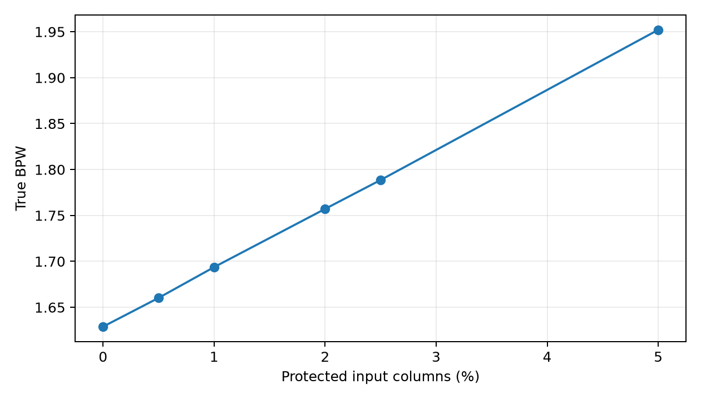

## I. Held-out functional accuracy

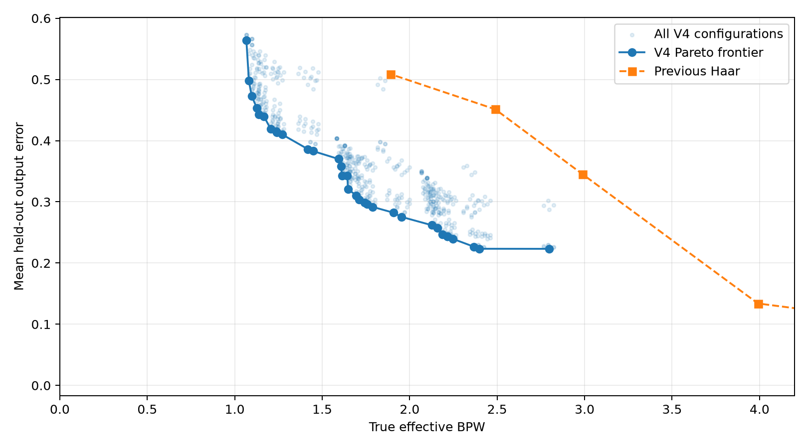

The best ≤2-BPW configuration improves mean held-out error from the previous 50.87% to 27.55%. Median is 28.01%, p90 is 43.94%, and worst-layer error is 57.86%. This is a major relative improvement, but it remains far from single-digit error. Calibration error is 25.45%, so held-out degradation is present but does not explain the main failure.

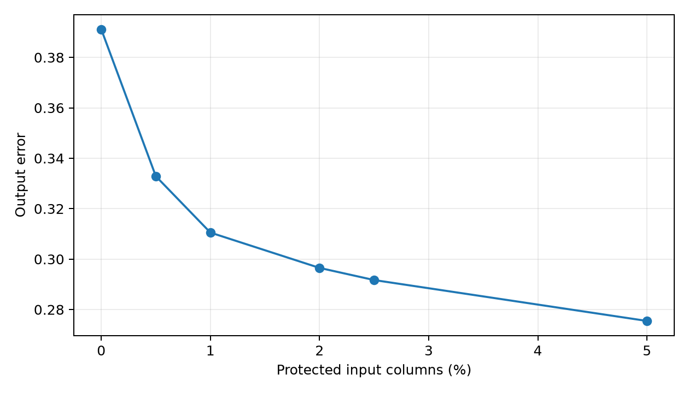

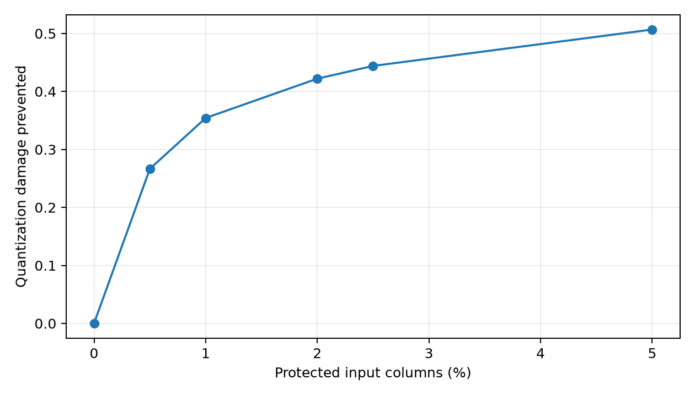

Bulk precision ablation:

| bulk_bits | bpw | error |
| --- | --- | --- |
| 1 | 1.44747 | 0.382943 |
| 1.5 | 1.95209 | 0.27548 |
| 2 | 2.39731 | 0.2233 |

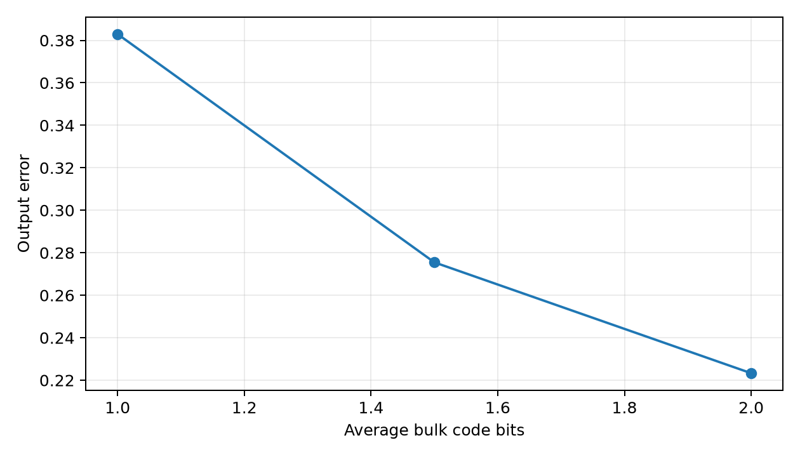

Bulk weights can be encoded at 1–1.5 average bits, but functional error remains too large for useful inference.

## J. Per-layer failures

Best ≤2-BPW error by layer type and position:

| type | stage | mean | median | max |
| --- | --- | --- | --- | --- |
| attention_output | middle | 0.357871 | 0.357871 | 0.357871 |
| dense_4h_to_h | middle | 0.316297 | 0.316297 | 0.316297 |
| dense_h_to_4h | middle | 0.28006 | 0.28006 | 0.28006 |
| down_proj | early | 0.287817 | 0.287817 | 0.287817 |
| down_proj | late | 0.178499 | 0.178499 | 0.178499 |
| down_proj | middle | 0.384108 | 0.384108 | 0.384108 |
| fc1 | middle | 0.189462 | 0.189462 | 0.189462 |
| fc2 | middle | 0.578602 | 0.578602 | 0.578602 |
| gate_proj | early | 0.252017 | 0.252017 | 0.252017 |
| gate_proj | late | 0.209128 | 0.209128 | 0.209128 |
| gate_proj | middle | 0.254526 | 0.254526 | 0.254526 |
| k_proj | early | 0.00252743 | 0.00252743 | 0.00252743 |
| k_proj | late | 0.174417 | 0.174417 | 0.174417 |
| k_proj | middle | 0.10033 | 0.126594 | 0.164913 |
| o_proj | early | 0.219499 | 0.219499 | 0.219499 |
| o_proj | late | 0.415354 | 0.415354 | 0.415354 |
| o_proj | middle | 0.485946 | 0.485946 | 0.485946 |
| out_proj | middle | 0.440381 | 0.440381 | 0.440381 |
| q_proj | early | 0.0100768 | 0.0100768 | 0.0100768 |
| q_proj | late | 0.184114 | 0.184114 | 0.184114 |
| q_proj | middle | 0.119338 | 0.0960293 | 0.204108 |
| up_proj | early | 0.435478 | 0.435478 | 0.435478 |
| up_proj | late | 0.285297 | 0.285297 | 0.285297 |
| up_proj | middle | 0.381849 | 0.381849 | 0.381849 |
| v_proj | early | 0.395286 | 0.395286 | 0.395286 |
| v_proj | late | 0.372523 | 0.372523 | 0.372523 |
| v_proj | middle | 0.446895 | 0.415453 | 0.550193 |

Worst individual layers:

| layer | bpw | test_output_error | test_output_cosine | weight_error |
| --- | --- | --- | --- | --- |
| facebook/opt-125m/model.decoder.layers.6.fc2@middle | 1.93496 | 0.578602 | 0.84915 | 0.535836 |
| EleutherAI/pythia-70m/gpt_neox.layers.3.attention.query_key_value.v_proj@middle | 1.95704 | 0.550193 | 0.852135 | 0.482743 |
| Qwen/Qwen2.5-0.5B/model.layers.12.self_attn.o_proj@middle | 1.93912 | 0.485946 | 0.881076 | 0.459934 |
| facebook/opt-125m/model.decoder.layers.6.self_attn.out_proj@middle | 1.93835 | 0.440381 | 0.899299 | 0.474788 |
| Qwen/Qwen2.5-0.5B/model.layers.0.mlp.up_proj@early | 1.9323 | 0.435478 | 0.900606 | 0.457687 |
| facebook/opt-125m/model.decoder.layers.6.self_attn.v_proj@middle | 1.93835 | 0.415453 | 0.90976 | 0.443304 |
| Qwen/Qwen2.5-0.5B/model.layers.23.self_attn.o_proj@late | 1.93912 | 0.415354 | 0.90974 | 0.492378 |
| Qwen/Qwen2.5-0.5B/model.layers.0.self_attn.v_proj@early | 2.01059 | 0.395286 | 0.920812 | 0.457183 |

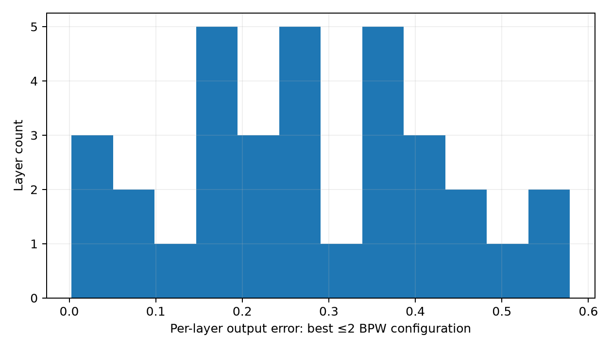

The remaining failure is not confined to one projection or position; the p90 and worst values show catastrophic layers remain.

## K. Pareto frontier

The Pareto CSV contains every nondominated aggregate point; raw measurements preserve all 26,920 configurations.

| bpw | error | saliency_metric | salient_fraction | salient_precision | bulk_transform | group_size | bulk_bits |
| --- | --- | --- | --- | --- | --- | --- | --- |
| 1.06642 | 0.564319 | activation_rms | 0 | 8 | none | 64 | 1 |
| 1.08102 | 0.497824 | activation_rms | 0.005 | 4 | none | 64 | 1 |
| 1.09665 | 0.473144 | activation_rms | 0.01 | 4 | none | 64 | 1 |
| 1.12623 | 0.453339 | activation_rms | 0.02 | 4 | none | 64 | 1 |
| 1.13687 | 0.442967 | activation_rms | 0.01 | 8 | none | 64 | 1 |
| 1.1678 | 0.439271 | activation_rms | 0.01 | 8 | none | 32 | 1 |
| 1.20583 | 0.41877 | activation_rms | 0.02 | 8 | none | 64 | 1 |
| 1.23645 | 0.415279 | activation_rms | 0.02 | 8 | none | 32 | 1 |
| 1.24004 | 0.413171 | activation_rms | 0.025 | 8 | none | 64 | 1 |
| 1.27052 | 0.410169 | activation_rms | 0.025 | 8 | none | 32 | 1 |
| 1.41779 | 0.386135 | activation_rms | 0.05 | 8 | none | 64 | 1 |
| 1.44747 | 0.382943 | activation_rms | 0.05 | 8 | none | 32 | 1 |
| 1.59414 | 0.369915 | activation_rms | 0.005 | 4 | none | 64 | 1.5 |
| 1.6071 | 0.357863 | activation_rms | 0.01 | 4 | none | 64 | 1.5 |
| 1.61356 | 0.343023 | activation_rms | 0.005 | 8 | none | 64 | 1.5 |
| 1.64377 | 0.342601 | activation_rms | 0.025 | 4 | none | 64 | 1.5 |
| 1.64731 | 0.320806 | activation_rms | 0.01 | 8 | none | 64 | 1.5 |
| 1.69372 | 0.310525 | activation_rms | 0.01 | 8 | none | 32 | 1.5 |
| 1.71121 | 0.303908 | activation_rms | 0.02 | 8 | none | 64 | 1.5 |
| 1.7429 | 0.298836 | activation_rms | 0.025 | 8 | none | 64 | 1.5 |
| 1.75713 | 0.296515 | activation_rms | 0.02 | 8 | none | 32 | 1.5 |
| 1.7886 | 0.291699 | activation_rms | 0.025 | 8 | none | 32 | 1.5 |
| 1.90756 | 0.282213 | activation_rms | 0.05 | 8 | none | 64 | 1.5 |
| 1.95209 | 0.27548 | activation_rms | 0.05 | 8 | none | 32 | 1.5 |
| 2.12682 | 0.261778 | activation_rms | 0.01 | 8 | none | 64 | 2 |
| 2.15774 | 0.257133 | activation_rms | 0.01 | 8 | none | 32 | 2 |
| 2.18593 | 0.246802 | activation_rms | 0.02 | 8 | none | 64 | 2 |
| 2.21526 | 0.243574 | activation_rms | 0.025 | 8 | none | 64 | 2 |
| 2.21656 | 0.243283 | activation_rms | 0.02 | 8 | none | 32 | 2 |
| 2.24573 | 0.239572 | activation_rms | 0.025 | 8 | none | 32 | 2 |
| 2.36763 | 0.226619 | activation_rms | 0.05 | 8 | none | 64 | 2 |
| 2.39731 | 0.2233 | activation_rms | 0.05 | 8 | none | 32 | 2 |
| 2.79672 | 0.223185 | activation_rms | 0.05 | 16 | none | 32 | 2 |

The V4 frontier moves substantially below the previous Haar curve, but plateaus well above acceptable error at 2–3 BPW.

## L. Residual structure

For the winning architecture family (activation-RMS 5%, INT8, direct 1.5-bit G=32 bulk), fraction of residual weight energy captured by largest entries:

| density | sparse_energy |
| --- | --- |
| 0.001 | 0.0493488 |
| 0.0025 | 0.0850386 |
| 0.005 | 0.127583 |
| 0.01 | 0.188383 |
| 0.02 | 0.270472 |
| 0.05 | 0.407203 |

Discovery-layer residual rank and distribution:

| layer | density | sparse_energy | kurtosis | rank1_energy | rank4_energy | rank8_energy | rank16_energy | rank32_energy |
| --- | --- | --- | --- | --- | --- | --- | --- | --- |
| Qwen/Qwen2.5-0.5B/model.layers.0.self_attn.q_proj@early | nan | nan | 18.9247 | 0.0753991 | 0.146484 | 0.202445 | 0.267587 | 0.357271 |

The residual remains distributed: neither a tiny sparse correction nor a small low-rank correction captures enough energy to solve the remaining error cheaply.

## M. Kernel feasibility estimate

The winner no longer uses Haar. Its conceptual decode path is: load a 5% irregular INT8 salient-column stream and indices, dequantize direct 1.5-bit grouped bulk codes with FP8 scales shared across four groups, then feed both paths into the linear accumulation. Stored traffic is 0.2440 bytes per original weight plus runtime alignment/container effects already excluded from BPW. There is no inverse-Haar arithmetic; bulk dequantization requires unpacking, a scale multiply per weight, and group bitwidth dispatch. The irregular salient path and mixed 1/2-bit bulk remain kernel challenges, but kernel work is not justified while mean error is 27.55%.

## N. Final verdict

V4 produces a major improvement over fixed Haar near 2 BPW, from 50.87% to 27.55%, so it earns PARTIAL rather than FAIL. It does not approach the required single-digit functional error, its worst layer remains 57.86%, and Haar is absent from the winning configuration. The next representation should retain activation-aware protected columns but replace the bulk path with additive codebooks, binary factorization, or a learned dictionary/transform.

WaveFly V4:
PARTIAL

Best configuration:
Saliency method: activation RMS
Salient fraction: 5%
Salient precision: INT8
Bulk transform: none
Bulk precision: 1.5-bit average
Group size: 32
Scale precision: FP8 E4M3, shared across 4 groups
True BPW: 1.952
Held-out output error: 27.55%
Worst-layer output error: 57.86%
