# WaveFly V5 experiment

## Verdict and scope

**PARTIAL.** Best deployable configuration selected by calibration A at ≤2 BPW: **+ static correction**, 1.9998 BPW, **18.71% mean held-out B output error**, 44.37% worst layer. Out-of-domain C mean: 18.55%.

The specification leaves 15–20% outside its explicit final-verdict examples. We label that interval PARTIAL because it meets the stated Stage 1 target (<20%), while explicitly acknowledging that it misses the 10–15% example for strong partial progress, Stage 2 (<10%), and near-lossless targets. This is not a strong pass.

This run covers 33 sampled matrices from Qwen2.5-0.5B, OPT-125M and Pythia-70M. Global BPW is weighted by the number of weights in these sampled matrices. It is **not a full-model storage measurement**. Error is ||X(W−W_hat)^T||F / ||XW^T||F, excluding bias. Layer errors are averaged without weight-count weighting. No perplexity or inference-speed result is implied.

The independent V4 reproduction audit gives 27.5456% with bias included, matching the earlier 27.55% result, and 29.7784% with bias excluded, at mean per-layer 1.952085 BPW. The latter is the fair baseline for V5's specified metric. Weight-count-weighted global BPW can differ from the earlier arithmetic layer mean.

Calibration A uses the first three V4 passages. Held-out B uses the two remaining V4 passages. C contains six new code, math, and general-text passages. Codebooks learn from weights; all saliency, configuration selection, and allocation use A only. B and C do not select configurations. These are small illustrative splits, not representative benchmark corpora, and B was used in earlier V4 development.

## Main table at a ≤2 BPW global budget

Errors below are percentages. Each row independently chooses the lowest calibration distortion from its available representation family. An expanded family can fall back to earlier representations; its name does not imply every layer uses the new component.

| method | bpw | mean | median | p90 | worst | error_a | error_c |
| --- | --- | --- | --- | --- | --- | --- | --- |
| V4 uniform | 1.93481 | 29.77842 | 28.46535 | 43.35954 | 55.90146 | 27.70429 | 29.63023 |
| Layer greedy | 1.99353 | 26.21836 | 25.49119 | 38.83921 | 45.14132 | 24.41955 | 26.13409 |
| Layer adaptive | 1.99805 | 26.17824 | 25.49119 | 38.83921 | 45.14132 | 24.38415 | 26.09154 |
| Group adaptive | 1.99932 | 20.88069 | 19.04885 | 37.17079 | 60.00111 | 19.05348 | 20.69552 |
| Learned scalar | 1.99989 | 19.41501 | 16.73266 | 34.89018 | 44.36522 | 17.60816 | 19.22286 |
| Vector base | 1.99974 | 19.09888 | 14.76654 | 36.81077 | 60.00111 | 17.35209 | 18.95524 |
| + static correction | 1.99984 | 18.70870 | 13.71379 | 35.39920 | 44.36522 | 17.00955 | 18.55409 |
| + oracle routing | 1.99984 | 18.70870 | 13.71379 | 35.39920 | 44.36522 | 17.00955 | 18.55409 |
| + learned routing | 1.99984 | 18.70870 | 13.71379 | 35.39920 | 44.36522 | 17.00955 | 18.55409 |

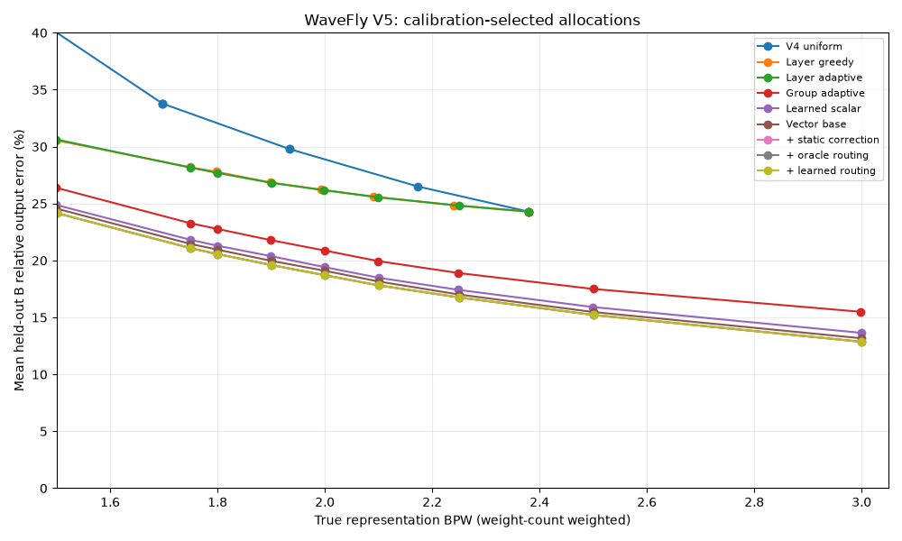

## Allocation and representation methods

Uniform V4 uses one bulk precision across layers. Greedy allocation purchases calibration error reduction per stored bit. Constrained allocation solves a multiple-choice mixed-integer problem with one representation per layer and exact weight-count-weighted storage. Solver time limit is 30 seconds per allocation; feasible solutions are reported, not a proof of global optimality if the solver times out. Every method includes a salient-only low-cost option, so low global budgets remain feasible and can drop difficult bulk paths.

Group adaptation uses G32, candidate precisions 1/2/3/4 bits, a two-bit group precision map, FP8 scales shared across four groups, and a Lagrangian allocation based on diagonal activation-weighted perturbation energy. Fractional precision means a mixture of integer group precisions. This sensitivity proxy omits activation covariance; final evaluation uses full matrix outputs.

Learned scalar codebooks use Lloyd iterations on normalized weights with FP16 stored levels. VQ uses 2/4/8-dimensional vectors, FP16 codebooks and FP16 G32 RMS scales. Codebooks are limited to 256 entries in this bounded initial run; 8D vectors therefore do not cover all high-BPW targets. Assignment tests Euclidean distance and a shared diagonal activation-weighted distance by vector position. Full covariance functional-distance VQ is not implemented. All reconstructions use the rounded stored codebooks, scales, factors and coefficients.

## Residuals and corrections

Residuals are analyzed for two calibration-selected base budgets (≤1.5 and ≤2 BPW) per layer, permitting corrections to replace some base storage. Randomized SVD estimates the top 32 singular directions; this is not a complete exact spectrum. Diagnostics include kurtosis, exact zero fraction, top-1% entry energy, top-5% channel/group energy, protected functional saliency, and mean absolute pairwise cosine between calibration residual-output samples.

Static candidates include ranks 1/2/4/8/16 with INT8 factors and FP16 scales; residual dictionaries with K=8/16/32/64, one/two/four matching-pursuit terms per G32 block, INT8 atoms, FP16 coefficients, and stored indices; and one/two/three binary planes with rounded FP16 amplitudes. All static correction payloads count toward the allocation budget.

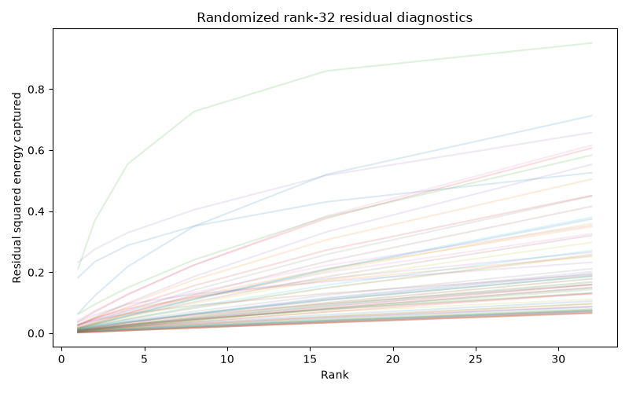
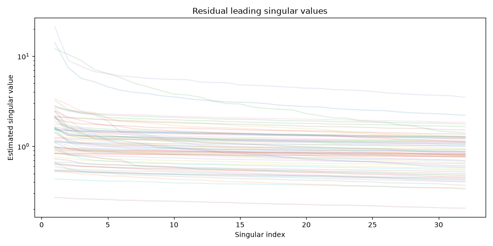
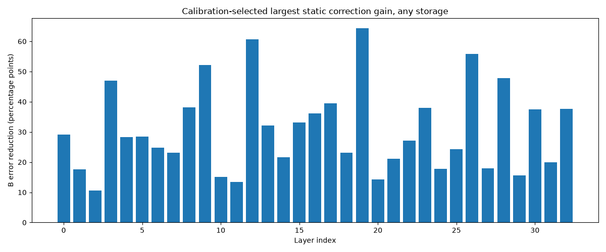
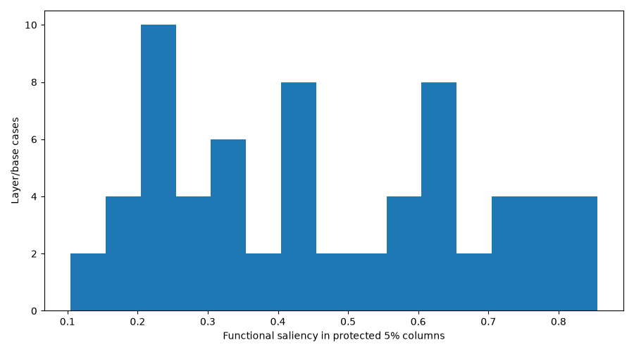

## Oracle and learned routing

The routing bank stores eight individually INT8-quantized rank-one factors. Dense matrices are materialized only for research evaluation; storage accounts for the factor representation. Original weights provide offline targets and are not required by deployment routing. Binary oracle selection greedily adds distinct beneficial paths, up to 1/2/4/8. It is an approximate oracle diagnostic, **not a proven theoretical optimum**. Its target-dependent decisions are not deployable and are excluded from best-system selection.

A tiny grouped-RMS linear router is trained only for layers whose calibration oracle reaches <10% error and at least 40% relative improvement at Top-1/2/4. This explicit gate is decided on A; no B/C result triggers training. Router weights, biases, and feature normalization are rounded to FP16 and counted. Ungated layers retain static/base choices. Learned router rows: 3. Routing metrics use all captured tokens, and path frequencies are retained in `results/v5/json/routing.json`.

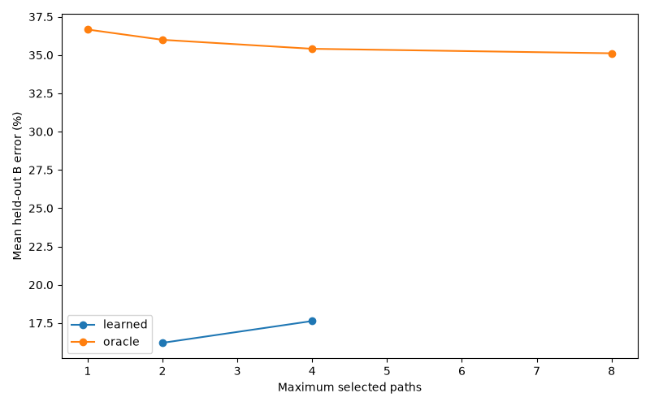
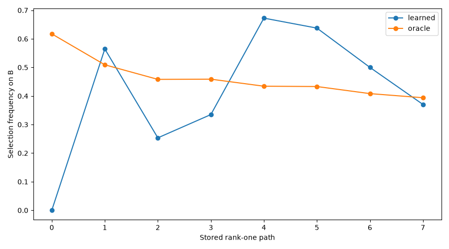
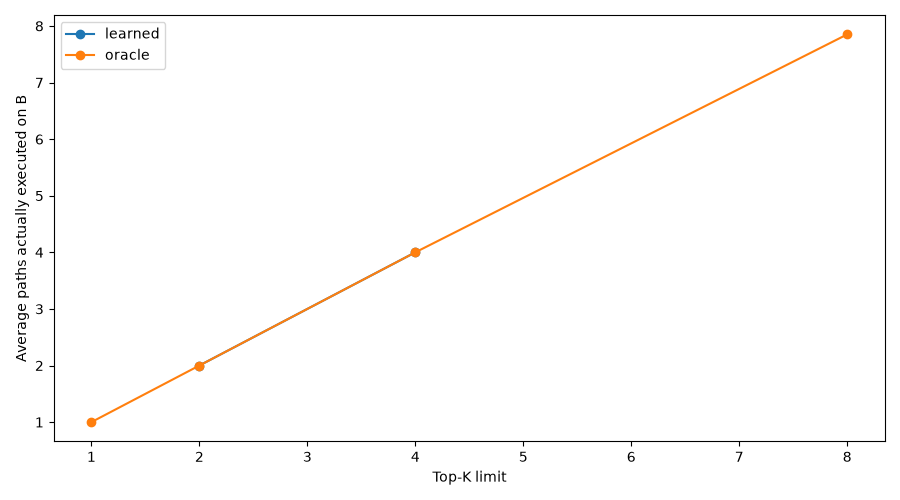

## Storage and hardware feasibility

The selected ≤2 BPW system uses 17 layers learned scalar, 1 layers group adaptive scalar, 9 layers V4 scalar, 6 layers vector. Selected corrections: 1 layers rank8, 3 layers binary3, 2 layers rank2. It selects no dynamic routing bank when all routing-family rows coincide with the static row. Some small hard matrices receive about 5 BPW while larger matrices receive less; the global sampled-weight average is bounded at 2 BPW. No per-layer 2-BPW cap is claimed.

Codes, shared scales, salient values/scales, salient indices, permutations, precision maps, codebooks, correction factors/atoms/coefficients, routers and headers are counted in bits, with each component byte-aligned. This is representation accounting, **not a physically serialized V5 codec or measured filesystem/container size**. Runtime tensors and dense research reconstructions are excluded. V4's separate packed DCT tests establish earlier codec mechanics, not V5 packing correctness.

| component | bpw |
| --- | --- |
| codes | 1.42630 |
| scales | 0.06978 |
| salient | 0.40146 |
| codebooks | 0.00037 |
| correction | 0.05822 |
| router | 0.00000 |
| metadata | 0.04370 |

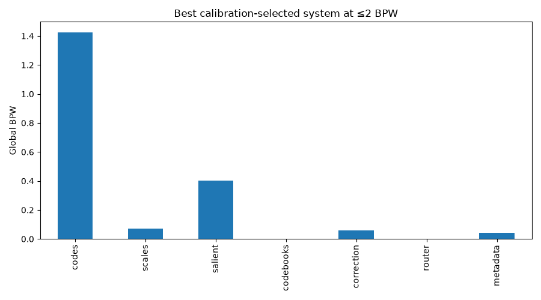

A rank-one selected path requires roughly 2(d_in+d_out) floating-point operations per token, plus accumulation. A grouped RMS router requires O(d_in) feature work and approximately 2 ceil(d_in/32) K multiply/add operations. Base work remains a full low-bit matrix multiply after decode/lookup. Dictionary correction may require substantial decoding and an extra dense GEMV; binary planes each add another weight-plane pass. No final kernel was built and no speedup is claimed. Static storage savings do not establish runtime savings.

## Hard-layer and generalization results

| layer | out | inp | config | bpw | error_a | error_b | error_c |
| --- | --- | --- | --- | --- | --- | --- | --- |
| Qwen/Qwen2.5-0.5B/model.layers.12.mlp.down_proj@middle | 896 | 4864 | v4_1.25 | 1.69382 | 0.39338 | 0.44365 | 0.46431 |
| Qwen/Qwen2.5-0.5B/model.layers.12.mlp.up_proj@middle | 4864 | 896 | v4_1.25 | 1.69486 | 0.40684 | 0.43767 | 0.43677 |
| Qwen/Qwen2.5-0.5B/model.layers.23.mlp.down_proj@late | 896 | 4864 | v4_0 | 0.41720 | 0.29498 | 0.39002 | 0.36036 |
| Qwen/Qwen2.5-0.5B/model.layers.23.mlp.up_proj@late | 4864 | 896 | v4_1+rank2 | 1.44888 | 0.33830 | 0.35415 | 0.35477 |
| Qwen/Qwen2.5-0.5B/model.layers.12.mlp.gate_proj@middle | 4864 | 896 | v4_1 | 1.42773 | 0.30625 | 0.35335 | 0.34781 |
| Qwen/Qwen2.5-0.5B/model.layers.0.mlp.up_proj@early | 4864 | 896 | v4_2 | 2.37751 | 0.32675 | 0.33112 | 0.33178 |
| Qwen/Qwen2.5-0.5B/model.layers.0.mlp.down_proj@early | 896 | 4864 | v4_1.25 | 1.69382 | 0.26354 | 0.32820 | 0.33475 |
| facebook/opt-125m/model.decoder.layers.6.fc2@middle | 768 | 3072 | learned_2.5 | 2.91472 | 0.21685 | 0.30395 | 0.30342 |
| Qwen/Qwen2.5-0.5B/model.layers.0.mlp.gate_proj@early | 4864 | 896 | v4_1.25 | 1.69486 | 0.28896 | 0.28904 | 0.29791 |
| Qwen/Qwen2.5-0.5B/model.layers.23.mlp.gate_proj@late | 4864 | 896 | v4_1+rank2 | 1.44888 | 0.23506 | 0.26659 | 0.23877 |

Errors in this diagnostic table are fractions. Per-layer correction alternatives and gains can be computed from `configurations.csv`; all selected configurations are in `allocations.csv`. Residual diagnostics and activation RMS are in `residual.csv`. Differences across A/B/C reveal calibration sensitivity; the limited passages cannot establish general language-model fidelity.

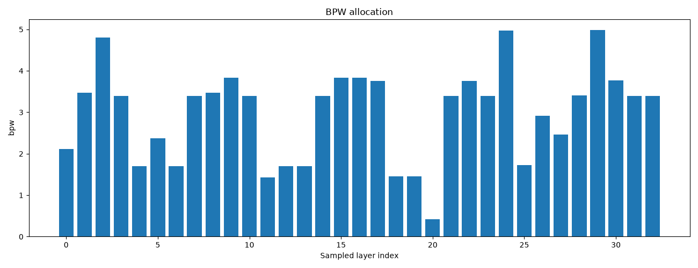
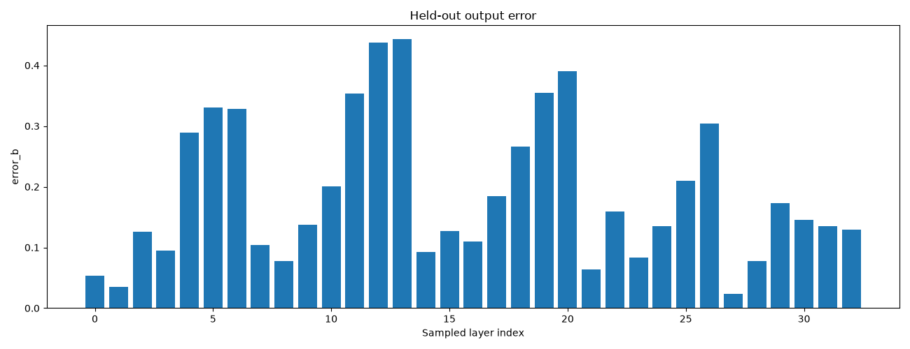

## Fifteen requested answers

1. Layer-adaptive versus uniform: uniform 29.78% B error at 1.9348 BPW; 29.63% on C; adaptive 26.18% B error at 1.9980 BPW; 26.09% on C.
2. Learned scalar versus V4: 19.42% B error at 1.9999 BPW; 19.22% on C.
3. Vector versus scalar: vector-enabled family 19.10% B error at 1.9997 BPW; 18.96% on C; compare item 2. This family can retain scalar on layers where it wins calibration.
4. Remaining residual structure: mean top-16 rank energy 0.1560; mean top-1% entry energy 0.1844; mean kurtosis 11.02. These quantify partial structure rather than prove randomness.
5. Static correction result: 18.71% B error at 1.9998 BPW; 18.55% on C. Per-layer selected correction types are recorded in allocations.
6. Oracle-enabled system: 18.71% B error at 1.9998 BPW; 18.55% on C. Approximate and target-dependent.
7. Cheap learned router: 3 gated layer/base/Top-K cases trained; learned-enabled system 18.71% B error at 1.9998 BPW; 18.55% on C. Cases that did not pass the calibration oracle gate were skipped.
8. Paths: Top-1/2/4/8 oracle budgets; Top-1/2/4 learned budgets only where gated. Full path frequencies are saved; static candidates have no input-dependent routing.
9. Best calibration-selected deployable system at ≤2: + static correction, 1.99984 BPW.
10. At ≤2.25: + static correction, 2.24984 BPW, 16.76% held-out error.
11. Mean B error at ≤2: 18.71%.
12. Worst-layer B error at ≤2: 44.37%.
13. Generalization: mean A 17.01%, B 18.71%, C 18.55%; these small splits are not a full benchmark.
14. Full-model perplexity gate: not reached; full-model perplexity was not run.
15. Component contributions: group adaptation provides the largest sequential mean-error reduction in this run (about 5.30 percentage points), followed by layer allocation (3.60 points). Learned scalar adds about 1.47 points, vector options 0.32, and static corrections 0.39. Routing adds zero to the selected ≤2 BPW result. These are differences between reoptimized systems, not isolated causal effects at fixed layer allocations.

## Reproduction and limitations

Run `python experiments/v5_experiment.py`, then `python experiments/v5_report.py`. Dependencies include PyTorch, transformers 4.56.2, pandas, NumPy, SciPy, and matplotlib. GPU/checkpoint information and failures are recorded under `results/v5/json`. The pod's pre-existing draft was replaced after finding invalid group reshapes, nonfunctional allocation, and broken router training; those draft results are not used.

This is a bounded dense-layer research run. No MoE, final GPU kernel, physical V5 pack/unpack, or full-model evaluation is claimed. Optional Haar selection is omitted because direct quantization won V4. Diagnostic omissions and VQ bounds above limit the conclusions; failure of these candidates does not establish failure of all learned/additive quantizers.

WaveFly V5 verdict:

PARTIAL

Best system: + static correction
Base representation: 17 layers learned scalar, 1 layers group adaptive scalar, 9 layers V4 scalar, 6 layers vector
Layer allocation: constrained multiple-choice allocation
Group allocation: representation-dependent G32
Saliency method: activation RMS
Salient fraction: 5%
Salient precision: INT8
Correction representation: 1 layers rank8, 3 layers binary3, 2 layers rank2
Correction dictionary size: no dictionary selected in the best ≤2 BPW system
Routing Top-K: none selected in the best ≤2 BPW system
Global BPW: 1.99984 (sampled matrices)
Mean held-out output error: 18.71%
P90 layer error: 35.40%
Worst-layer error: 44.37%
Oracle routing error: 18.71% B error at 1.9998 BPW; 18.55% on C
Learned routing error: 18.71% B error at 1.9998 BPW; 18.55% on C
