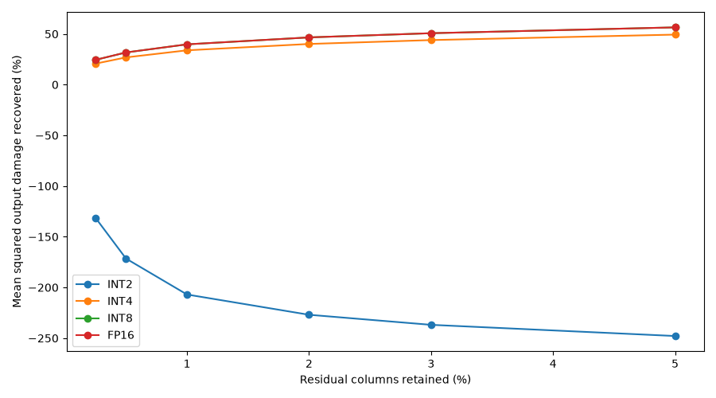
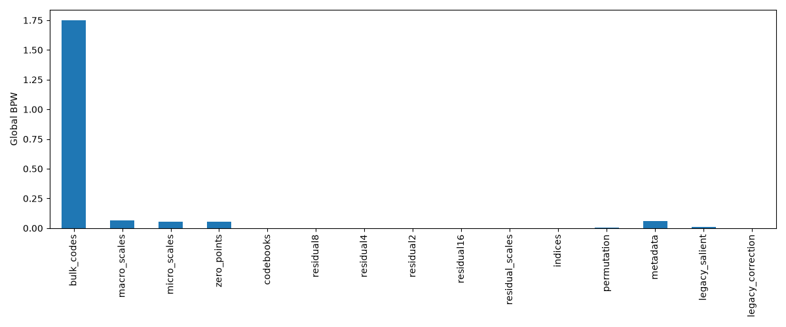
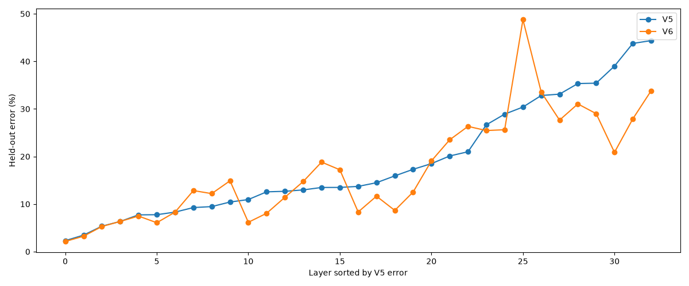
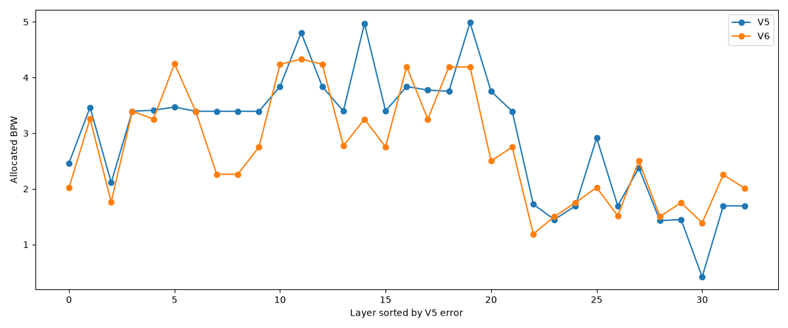
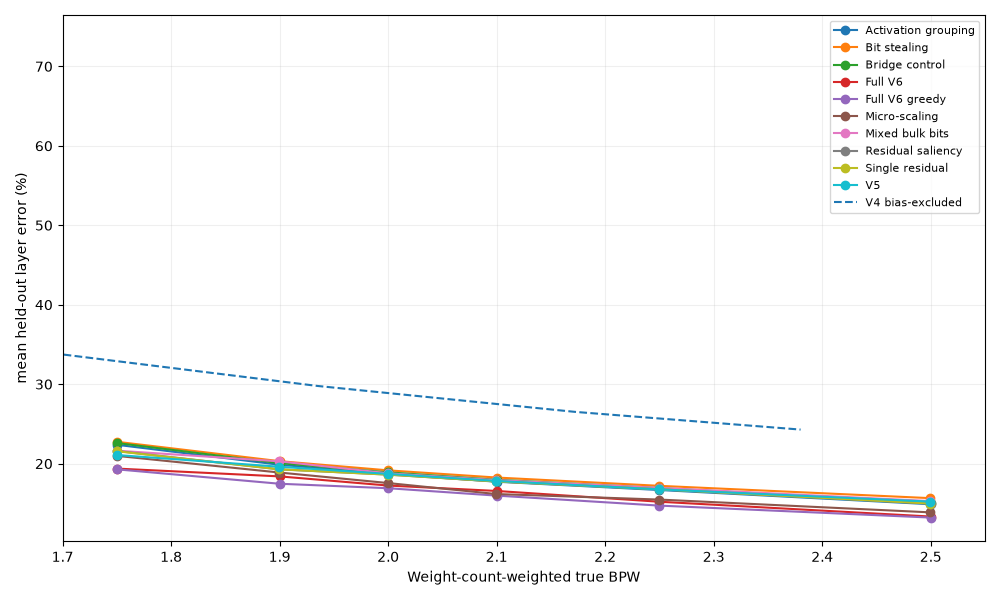
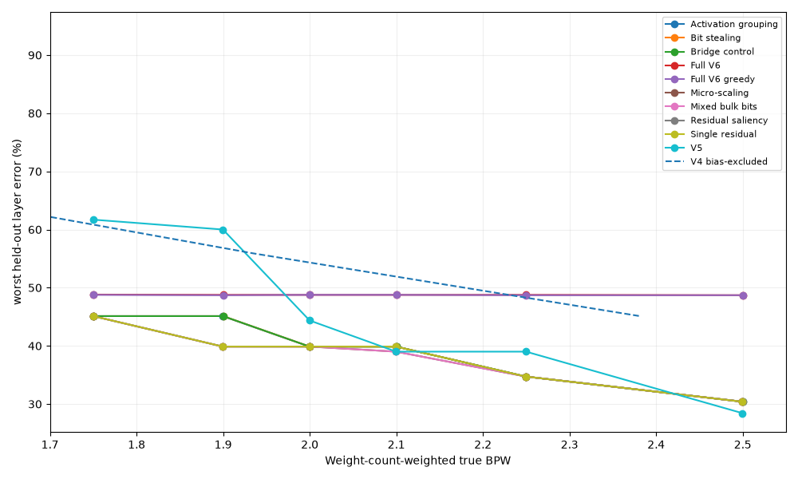
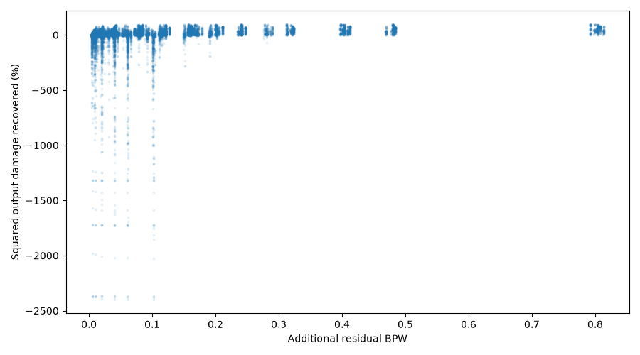

# WaveFly V6 experiment

## 1. V5 baseline reproduction

V5 was independently rerun on the same RTX 2000 Ada, same checkpoint revisions, same 33 matrices, and unchanged A/B/C texts and bias-excluded metric. Selected V5 representations reproduce with maximum absolute B-error difference **0.00026587** and identical counted bits. The rerun mean is 18.7078% versus historical 18.7087%; the small run-to-run variation is retained in the audit. The control is 1.999837 BPW, 18.71% mean, 44.37% worst, and 18.55% new-domain error.

Global BPW refers to the weight-count-weighted union of the sampled matrices across three models, not a deployed complete model. Errors are relative output Frobenius norms, not token error rates or perplexity. B was used in earlier development; C contains six additional passages. Neither B nor C chooses V6 representations or allocation.

## 2. Cross-layer bit allocation

V5 already used cross-layer allocation. V6 adds an explicit worst-layer penalty and expands candidate representations; it does not claim bit stealing was absent from V5. The objective is mean calibration error + λ × maximum calibration error (ω_l=1/33). Primary λ=0.25 was fixed before evaluation; λ=0 and 1 are diagnostic tradeoffs at 2 BPW. Greedy gain-per-stored-bit and a discrete constrained optimizer are both reported. The solver uses a 15-second limit and retains feasible solutions; statuses/gaps are in `json/solver.json`.

The uniform-cap reference restricts each layer to ≤2 BPW and can leave global capacity unused; its actual BPW is shown. It is distinct from the already adaptive V5 control. All other comparisons enforce the global budget, allowing small hard layers to exceed 2 BPW. Per-layer distortion curves cover caps 1/1.25/1.5/1.75/2/2.25/2.5/3/4, including actual attainable rates and marginal gains.

| method | lam | bpw | mean | worst | calibration | cal_worst |
| --- | --- | --- | --- | --- | --- | --- |
| V5 | 0.00000 | 1.99984 | 0.18709 | 0.44365 | 0.17010 | 0.40684 |
| Bit stealing | 0.25000 | 1.99997 | 0.19153 | 0.39870 | 0.17418 | 0.31577 |
| Full V6 greedy | 0.25000 | 1.99987 | 0.16906 | 0.48766 | 0.12230 | 0.25687 |
| Full V6 lambda sweep | 0.00000 | 1.99995 | 0.16537 | 0.48706 | 0.12117 | 0.29724 |
| Full V6 lambda sweep | 1.00000 | 1.99990 | 0.18500 | 0.52474 | 0.13477 | 0.21551 |
| Uniform per-layer cap | 0.00000 | 1.98394 | 0.28884 | 0.53497 | 0.26694 | 0.51304 |

Errors in diagnostic tables are fractions unless labelled percentages.

## 3. Residual-driven saliency

After bulk quantization, scores compare residual-column norm, activation RMS × residual norm, activation RMS alone, and original weight norm × activation RMS. Squared direct functional damage is exactly the square of activation RMS × residual norm times the token count, so it has the same ranking; this equivalence avoids a redundant numerical sweep.

Residual fractions are 0.25/0.5/1/2/3/5%, with INT2/4/8 and FP16 references. Corrections store the actual residual, including under the original-score controls. This isolates selection criteria; it is not an exact implementation of V5's remove-original-columns path, which remains available as a separate legacy candidate.

Matched diagnostic: 1.5-bit preliminary bulk, 1% residual columns, INT8 correction (errors and recovered damage are fractions):

| residual_metric | error_b | damage_recovered_b | bpw |
| --- | --- | --- | --- |
| activation_rms | 0.39591 | 0.38674 | 1.67715 |
| functional | 0.38838 | 0.41015 | 1.67715 |
| magnitude | 0.45429 | 0.21936 | 1.67715 |
| original_functional | 0.40135 | 0.37326 | 1.67715 |

## 4. Activation-aware grouping

Orderings are original, activation-RMS sort, residual-RMS sort, activation×residual sort, lightweight normalized four-feature clustering, block-local (128 channels), and a shared ordering for matching model/input width. Residual features come from a fixed 1.5-bit preliminary quantizer. No expensive permutation search is used. Every ordering has an exact reconstruction/bijection assertion.

Full permutations count ceil(log2 input_width) bits per input channel. Block-local counts seven bits per channel. Shared orderings are conservatively charged in every layer; no unimplemented storage-sharing discount is taken. Activation-dependent sorted order cannot be reconstructed implicitly from codes at deployment, so it is not treated as free. Original order needs no permutation. Row permutations are not added in V6.

## 5. Nested micro-scaling

One FP8 E4M3 macro scale covers four G32 groups. Optional two-bit micro codes select fixed [0.5,0.75,1,1.5] or one globally learned four-entry FP16 multiplier table. The learned table uses pooled weight-derived group/macro RMS ratios across all sampled matrices, without B/C activations, and is conservatively charged in every layer. No floating-point micro value is stored per group.

Zero-point choices use 0/1/2 bits per group. Fixed codebook shifts are [0], [-0.25,0.25], or [-0.5,-1/6,1/6,0.5]. Local candidates are chosen by either weight MSE or full calibration covariance within G32. This includes within-group correlations but omits cross-group terms during local selection; final layer-output evaluation is exact. Macro RMS is rounded to FP8 before fitting/assignment. Learned scalar levels and multiplier tables are rounded to FP16 before use. Identical codebook seeds hold the base fit fixed across scale ablations.

## 6. Mixed bulk precision

Bulk options are 1/2/3/4-bit learned scalar codes. Fractional uniform controls distribute the next precision evenly across groups. Mixed allocation instead minimizes block-functional distortion with a Lagrange multiplier and counts a two-bit precision tag per group. Actual cost includes all codes and metadata; requested average bulk bits are not substituted for total BPW.

## 7. Mixed residual precision

Single-precision corrections compete against cascades assigning the highest residual-score columns INT8, the next INT4, and the rest INT2, using three predefined tier proportions. Each corrected column stores its value stream and FP16 scale (FP16 reference values need no quantization scale), plus packed indices or the cheaper bitmap. Cascade precision tags add two bits per retained column. Full V6 excludes FP16 residual-reference candidates.

## 8. Full V6 joint optimization

Independent ablations run first within each layer. Orderings and micro-scale choices are shortlisted using calibration error at matched attainable rates near 2 BPW; unchanged controls remain available. Joint candidates combine winning order/scale options with mixed group precision. Bases selected under 1.25/1.5/1.75/2 BPW are refined with residual sweeps, allowing global allocation to trade bulk against correction storage. The final candidate union includes all V5 static candidates and V6 candidates; calibration Pareto pruning discards dominated choices without deleting their raw measurements. Dynamic routing is absent.

The selected scope counts are {'joint_base': 26, 'scaling': 4, 'legacy': 2, 'joint': 1}. Selected scaling: {'fixed': 18, 'learned': 12, 'off': 3}. Selected grouping: {'original': 15, 'features': 11, 'activation_residual': 2, 'residual': 2, 'V5': 2, 'activation': 1}. Selected residual precisions: {'8': 1}. Full V6 can retain V5 representations when new components fail to earn their cost.

## 9. Exact BPW accounting

| component | bpw | bytes |
| --- | --- | --- |
| bulk_codes | 1.75035 | 12023172.00000 |
| macro_scales | 0.06243 | 428856.00000 |
| micro_scales | 0.05620 | 386048.00000 |
| zero_points | 0.05486 | 376832.00000 |
| codebooks | 0.00032 | 2220.00000 |
| residual8 | 0.00168 | 11520.00000 |
| residual4 | 0.00000 | 0.00000 |
| residual2 | 0.00000 | 0.00000 |
| residual16 | 0.00000 | 0.00000 |
| residual_scales | 0.00000 | 30.00000 |
| indices | 0.00000 | 23.00000 |
| permutation | 0.00617 | 42368.00000 |
| metadata | 0.05944 | 408286.00000 |
| legacy_salient | 0.00852 | 58520.00000 |
| legacy_correction | 0.00000 | 0.00000 |

Each component is byte aligned. V5 candidates retain their original complete codebook/salient/static-correction costs; their combined metadata remains classified as legacy metadata because the old CSV did not split every index stream. This is an explicit representation size model, not a physically serialized V6 container. Offline dense reconstructed tensors and original reference weights are not deployment payload. No claim of V6 pack/unpack validation is made.

## 10. Held-out accuracy

At 1.999984 BPW: mean **17.24%**, median 14.74%, P90 30.64%, worst **48.77%**, standard deviation 10.80%.

## 11. OOD/generalization

Calibration mean 12.49%; held-out B 17.24%; different-domain C 17.09%. These short fixed passages cannot establish model-level generalization or language-model accuracy.

## 12. Worst-layer rescue

All V5 layers above 25% B error appear below. For a retained legacy static correction, an isolated bulk measurement may not exist in this table; such rows repeat final error as bulk and zero gain rather than invent a decomposition.

| layer | error_b_v5 | bpw_v6 | bulk_error | residual_gain | error_b_v6 |
| --- | --- | --- | --- | --- | --- |
| Qwen/Qwen2.5-0.5B/model.layers.0.mlp.gate_proj@early | 0.28904 | 1.75227 | 0.25626 | 0.00000 | 0.25626 |
| Qwen/Qwen2.5-0.5B/model.layers.0.mlp.up_proj@early | 0.33112 | 2.50021 | 0.27651 | 0.00000 | 0.27651 |
| Qwen/Qwen2.5-0.5B/model.layers.0.mlp.down_proj@early | 0.32820 | 1.51472 | 0.33512 | 0.00000 | 0.33512 |
| Qwen/Qwen2.5-0.5B/model.layers.12.mlp.gate_proj@middle | 0.35335 | 1.50226 | 0.31052 | 0.00000 | 0.31052 |
| Qwen/Qwen2.5-0.5B/model.layers.12.mlp.up_proj@middle | 0.43767 | 2.25227 | 0.27900 | 0.00000 | 0.27900 |
| Qwen/Qwen2.5-0.5B/model.layers.12.mlp.down_proj@middle | 0.44365 | 2.01472 | 0.33805 | 0.00000 | 0.33805 |
| Qwen/Qwen2.5-0.5B/model.layers.23.mlp.gate_proj@late | 0.26659 | 1.50227 | 0.25455 | 0.00000 | 0.25455 |
| Qwen/Qwen2.5-0.5B/model.layers.23.mlp.up_proj@late | 0.35415 | 1.75227 | 0.29008 | 0.00000 | 0.29008 |
| Qwen/Qwen2.5-0.5B/model.layers.23.mlp.down_proj@late | 0.39002 | 1.38970 | 0.20869 | 0.00000 | 0.20869 |
| facebook/opt-125m/model.decoder.layers.6.fc2@middle | 0.30395 | 2.02401 | 0.56828 | 0.08061 | 0.48766 |

## 13. Ablation results

Percentages below. Each independent ablation adds only its candidate family to V5 plus the common V6 bridge control. Bit-stealing uses unchanged V5 candidates. λ is held at 0.25 across new families. Thus gains are matched-budget system gains after calibration allocation, not a claim that each selected layer used the added component. Failed/fallback configurations remain in the raw CSV.

| method | bpw | mean | median | p90 | worst | std | ood |
| --- | --- | --- | --- | --- | --- | --- | --- |
| V5 | 1.99984 | 18.70870 | 13.71379 | 35.39920 | 44.36522 | 11.89550 | 18.55409 |
| Bit stealing | 1.99997 | 19.15276 | 17.30239 | 33.53145 | 39.87044 | 10.64318 | 18.98288 |
| Bridge control | 1.99988 | 18.90441 | 16.04604 | 33.29425 | 39.87044 | 10.63279 | 18.70330 |
| Single residual | 1.99992 | 18.61661 | 13.23461 | 32.89112 | 39.87044 | 10.87028 | 18.42471 |
| Residual saliency | 1.99992 | 18.61661 | 13.23461 | 32.89112 | 39.87044 | 10.87028 | 18.42471 |
| Activation grouping | 1.99974 | 18.69173 | 15.84116 | 33.53145 | 39.87044 | 10.81824 | 18.50611 |
| Micro-scaling | 1.99987 | 17.55694 | 12.57263 | 34.00564 | 39.87044 | 11.62470 | 17.20768 |
| Mixed bulk bits | 1.99997 | 18.78358 | 13.49831 | 35.02233 | 39.87044 | 11.25588 | 18.54779 |
| Full V6 | 1.99998 | 17.24111 | 14.74266 | 30.64310 | 48.76620 | 10.80433 | 17.08889 |
| Full V6 greedy | 1.99987 | 16.90575 | 12.41819 | 33.74622 | 48.76620 | 11.51052 | 16.70223 |
| Uniform per-layer cap | 1.98394 | 28.88372 | 27.54423 | 42.91336 | 53.49687 | 12.05192 | 28.64546 |

| component | before | after | gain | bpw_difference |
| --- | --- | --- | --- | --- |
| Bit stealing | 18.70870 | 19.15276 | -0.44406 | 0.00014 |
| Residual saliency | 18.90441 | 18.61661 | 0.28780 | 0.00004 |
| Activation grouping | 18.90441 | 18.69173 | 0.21268 | -0.00014 |
| Micro-scaling | 18.90441 | 17.55694 | 1.34747 | -0.00000 |
| Mixed bulk bits | 18.90441 | 18.78358 | 0.12083 | 0.00010 |
| Mixed residual | 18.61661 | 18.61661 | 0.00000 | 0.00000 |

## 14. Pareto frontier

## 15. Kernel feasibility

The selected representation accounts for 13,737,875 total bytes across sampled matrices. Bulk lookup/unpack is roughly one code operation per weight; nested scaling requires one macro×micro product per G32, then a dequantization multiply per weight. Zero points add a subtraction. Matrix arithmetic is approximately two FLOPs per weight per token, plus correction work. Residual column corrections use contiguous stored columns with O(retained_columns) index reads and approximately 2×stored_residual_values multiply/add operations per token. They require no per-weight index table. Full permutations do require an input gather; block-local/original ordering reduce its scope.

The ideal weight-only intensity is approximately 16/BPW FLOPs per payload byte for single-token dense matvec, before activation/output traffic and correction overhead. No runtime advantage follows from that estimate. Research evaluation materializes dense reconstructions; a proposed fused deployment must decode in registers/shared memory and avoid global-memory reconstruction. No final CUDA/Triton kernel or runtime benchmark was produced.

## 16. Final verdict and scientific questions

**FAIL**. Minimum target (mean <15%, worst <35%): False. Strong-progress target (mean <10%, worst <20%): False. Strong-pass target (mean <5%, worst <10%): False. The final requested labels omit a separate minimum-PASS label, so a minimum-only pass is labelled PARTIAL.

1. Bit stealing versus V5: see fixed-candidate λ table; worst-layer behavior is explicitly optimized on A and measured on B.
2. Easy-layer breakpoints: attainable distortion curves at caps 1–4 BPW are saved in `distortion_curves.csv`; selected minimum layer rate is 1.1879 BPW. No universal safe cutoff is asserted.
3. Layers deserving >2 BPW are identified in `allocations.csv` and the hard-layer table; allocation is based on calibration, not B labels.
4. Residual-based versus original-score saliency: the matched 1%-INT8 diagnostic is won by functional; its complete matched numbers appear in section 3. Global selections can choose a different fraction/precision.
5. At 1% INT8 columns on the 1.5-bit base, functional residual ranking recovers 41.02% of squared held-out output damage on average. Cross-column cancellation makes score concentration differ from actual recovery.
6. Grouping: the independent activation-grouping ablation reports whether it earns its permutation cost relative to the common bridge.
7. Micro-scales: the scaling ablation charges exactly two bits per G32 plus the table and reports matched-budget gain.
8. Asymmetry: all 0/1/2-bit choices are retained; selected zero-point counts are {2.0: 29, 0.0: 3, 1.0: 1}.
9. Mixed residual versus single precision: adding cascade choices changes matched-global-budget mean error from 18.62% to 18.62%. Chosen full-system precision mix is {'8': 1}.
10. Largest independent mean-error gain: Micro-scaling, 1.35 percentage points relative to its documented control at matched budget. Negative gain means regression.
11. Mean below 10% at 2 BPW: False.
12. Worst below 20%: False.
13. New-domain mean is 17.09%; representative benchmarks remain necessary.
14. Full-model gate (mean <10% and worst <20%): False. Perplexity and downstream benchmarks are not run because the local gate was not met.
15. Kernel regularity: G32 codes, macro/micro scales and column corrections are structured; arbitrary permutations and retained V5 paths still need implementation and timing before an efficiency claim.

WAVEFLY V6 FINAL RESULT

V5 baseline:
Global BPW: 1.999837
Mean held-out error: 18.71%
Worst-layer error: 44.37%

Full V6:
Global BPW: 1.999984
Mean held-out error: 17.24%
Median error: 14.74%
P90 error: 30.64%
Worst-layer error: 48.77%
New-domain error: 17.09%

Best layer BPW: 2.021118
Worst/hardest layer BPW: 2.024011

Bulk representation: calibration-selected V5/V6 static candidates
Group size: 32
Macro scale: FP8 for new V6 scalar candidates; legacy formats retained where selected
Micro-scale: {'fixed': 18, 'learned': 12, 'off': 3}
Residual strategy: functional column correction or retained V5 static paths
Residual precision mix: {'8': 1}
Permutation/grouping strategy: {'original': 15, 'features': 11, 'activation_residual': 2, 'residual': 2, 'V5': 2, 'activation': 1}

Ablation winner: Micro-scaling
Largest single improvement: 1.35 percentage points

Verdict:
FAIL
